# lmblender

**Blender's Cycles path tracer as one static executable, driven by short lmscript scenes: no Blender install, no Python, no GPU.**

[](https://github.com/lmctl-ai/lmblender/actions/workflows/ci.yml)
[](https://github.com/lmctl-ai/lmblender/releases)
[](LICENSE)

Every picture below is made by one example program. Each one runs from a raw URL with `lmctl autorun`, installs lmblender for your platform on first use, and writes `images/<name>.png` in the current directory in well under a minute on a four-core CPU.

### Light and optics

| Ball-lens caustic | Sunset and long shadows | Sunbeams in a dusty room |
| --- | --- | --- |
| 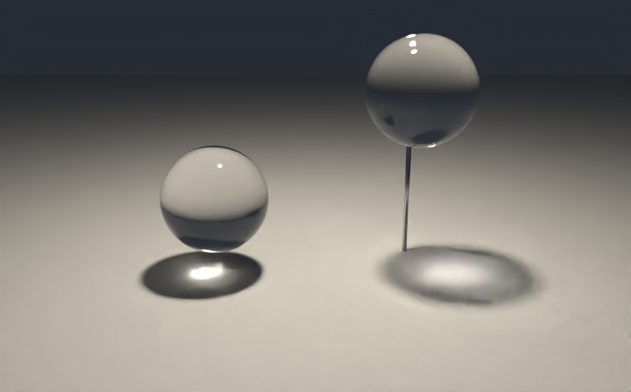 | 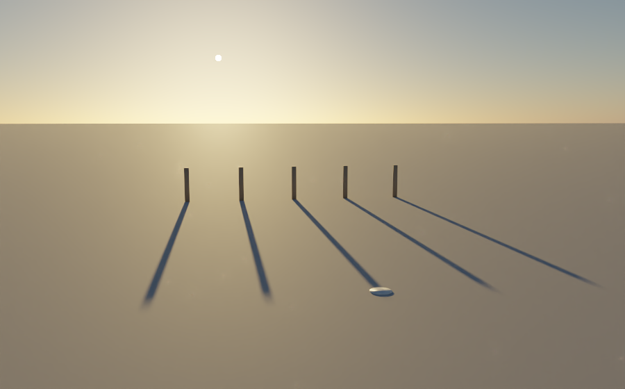 | 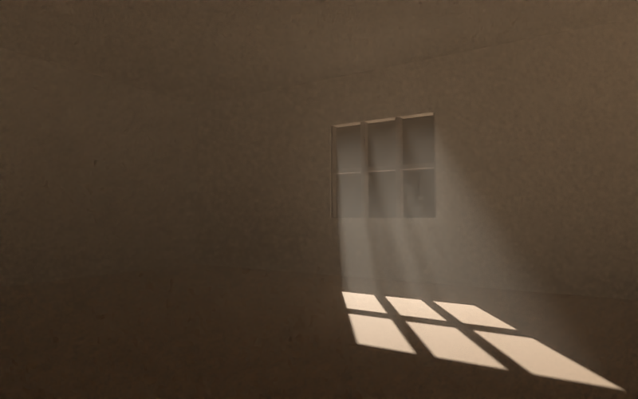 |
| A glass ball focuses at f = nR / (2(n-1)) = 1.5 R: at focus vs past it<br>`lmctl autorun https://raw.githubusercontent.com/lmctl-ai/lmblender/main/examples/caustic-ball-lens.lms` | Sun at 6°: 8.9 air masses redden it; shadows are h/tan 6° = 9.5 h<br>`lmctl autorun https://raw.githubusercontent.com/lmctl-ai/lmblender/main/examples/sunset-long-shadows.lms` | Haze scatters 6%/m of each beam; parallel shafts, sharp floor patches<br>`lmctl autorun https://raw.githubusercontent.com/lmctl-ai/lmblender/main/examples/god-rays-window.lms` |

### Global illumination and materials

| Cornell box | Why a backlit hand glows red | CAD to product shot |
| --- | --- | --- |
| 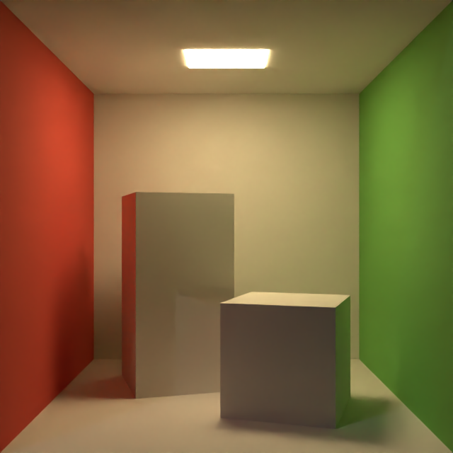 | 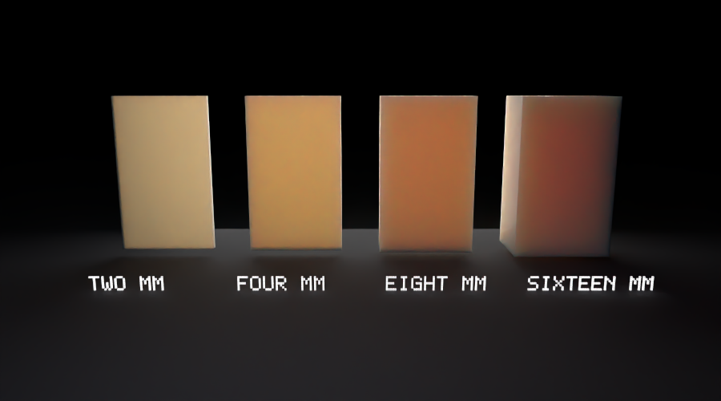 | 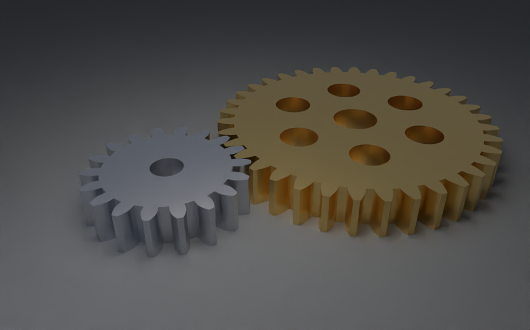 |
| The classic GI test: white blocks pick up red and green bounce light<br>`lmctl autorun https://raw.githubusercontent.com/lmctl-ai/lmblender/main/examples/cornell-box.lms` | Measured skin mean free paths (red 3.7 mm, blue 0.7 mm) vs thickness<br>`lmctl autorun https://raw.githubusercontent.com/lmctl-ai/lmblender/main/examples/backlit-skin.lms` | lmcad builds involute gears (2:1, a = 54 mm), lmblender renders them<br>`lmctl autorun https://raw.githubusercontent.com/lmctl-ai/lmblender/main/examples/gear-pair-render.lms` |

### Molecules and crystals

| Caffeine molecule | B-DNA double helix | Rock salt at true ionic size |
| --- | --- | --- |
| 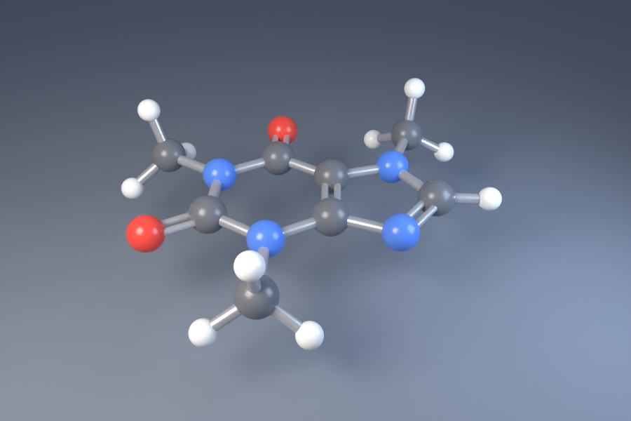 | 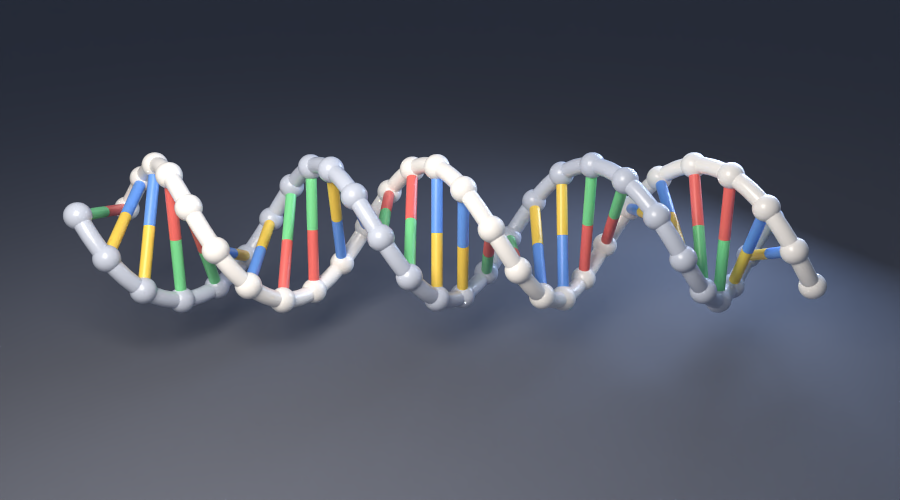 | 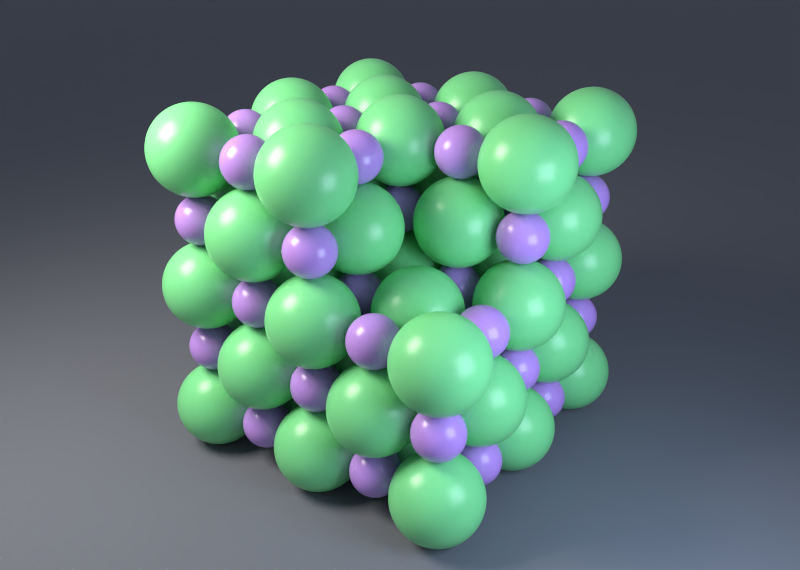 |
| C8H10N4O2: purine core, two C=O, three N-methyls, CPK colours<br>`lmctl autorun https://raw.githubusercontent.com/lmctl-ai/lmblender/main/examples/caffeine-molecule.lms` | 10.5 bp per turn, 0.34 nm rise; 144° backbone offset makes the grooves<br>`lmctl autorun https://raw.githubusercontent.com/lmctl-ai/lmblender/main/examples/dna-double-helix.lms` | Na+ 1.02 Å + Cl- 1.81 Å = a/2: ions touch along every cube edge<br>`lmctl autorun https://raw.githubusercontent.com/lmctl-ai/lmblender/main/examples/salt-crystal.lms` |

### Space and motion

| Saturn and its rings to scale | Kepler's second law | Strobe photo of a bouncing ball |
| --- | --- | --- |
| 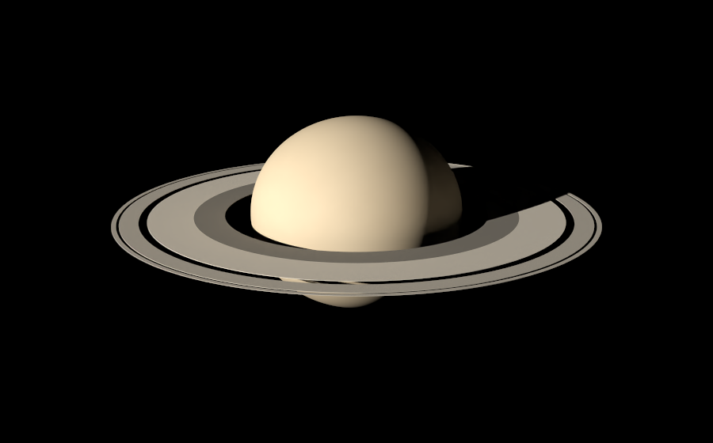 | 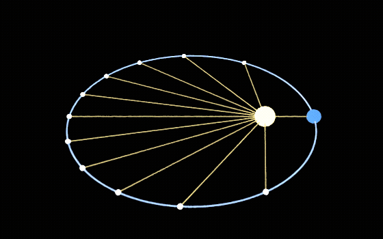 | 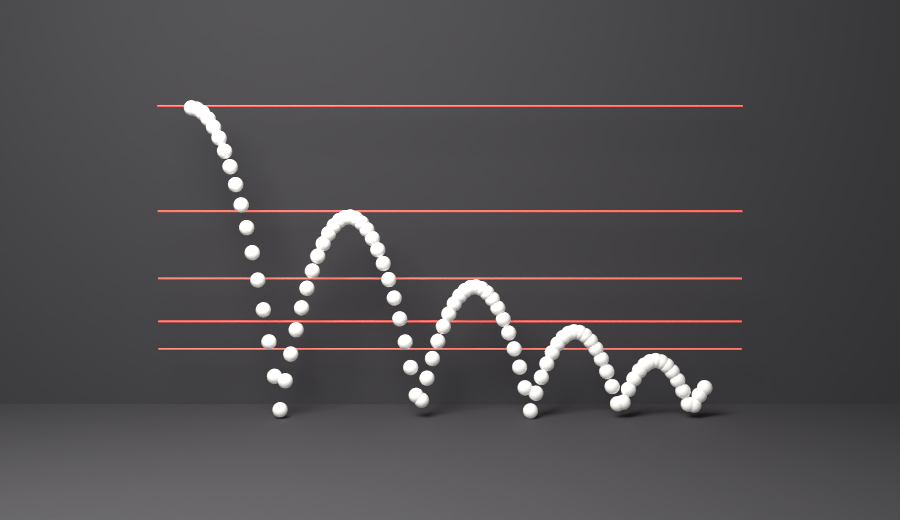 |
| Ring radii from 1.24 to 2.27 planet radii, Cassini Division at 1.95<br>`lmctl autorun https://raw.githubusercontent.com/lmctl-ai/lmblender/main/examples/saturn-rings.lms` | Kepler equation solved per frame; equal areas in equal times (GIF)<br>`lmctl autorun https://raw.githubusercontent.com/lmctl-ai/lmblender/main/examples/kepler-orbit.lms` | Restitution 0.8: each peak is 0.64 of the last; spacing shows speed<br>`lmctl autorun https://raw.githubusercontent.com/lmctl-ai/lmblender/main/examples/bouncing-ball-strobe.lms` |

### Scenes shared with lmcad, lmmagnum and lmfilament

| Water molecule | Buckminsterfullerene C60 | Pratt truss footbridge |
| --- | --- | --- |
| 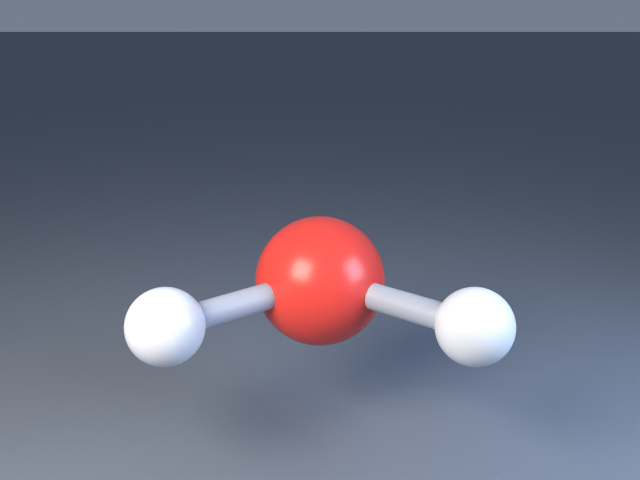 | 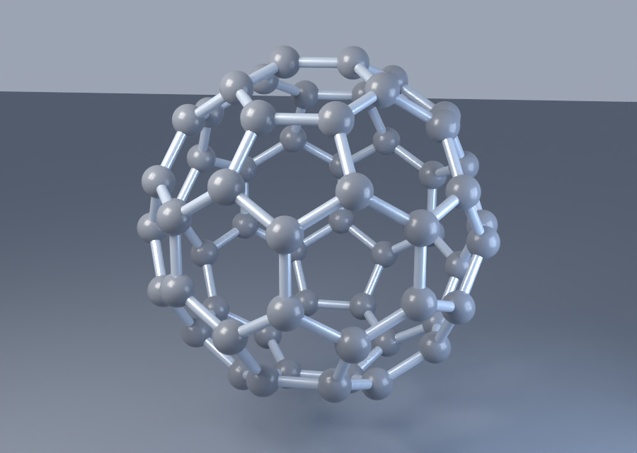 | 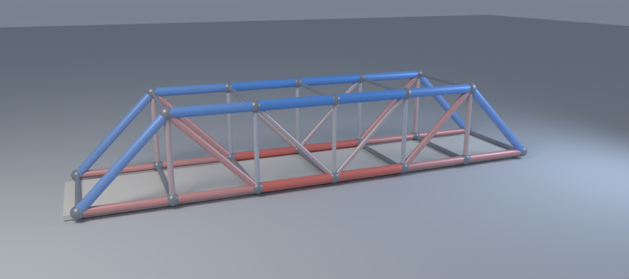 |
| 104.5 degree H-O-H angle (from lmcad)<br>`lmctl autorun https://raw.githubusercontent.com/lmctl-ai/lmblender/main/examples/ball-stick.lms` | 60 atoms from icosahedral symmetry, 90 bonds (from lmcad)<br>`lmctl autorun https://raw.githubusercontent.com/lmctl-ai/lmblender/main/examples/buckyball.lms` | Red tension, blue compression, closed-form member forces (from lmcad)<br>`lmctl autorun https://raw.githubusercontent.com/lmctl-ai/lmblender/main/examples/truss-bridge.lms` |

| Metal roughness sweep | Material sandbox | Model viewer |
| --- | --- | --- |
| 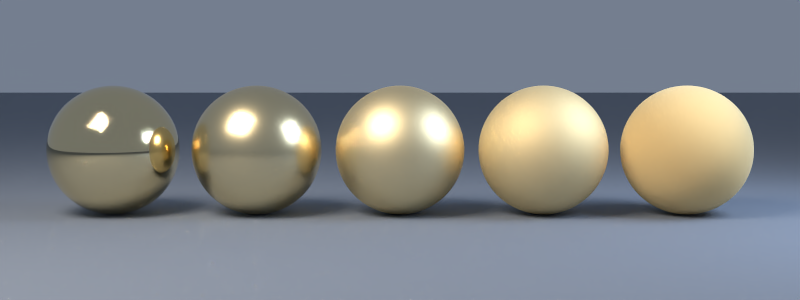 | 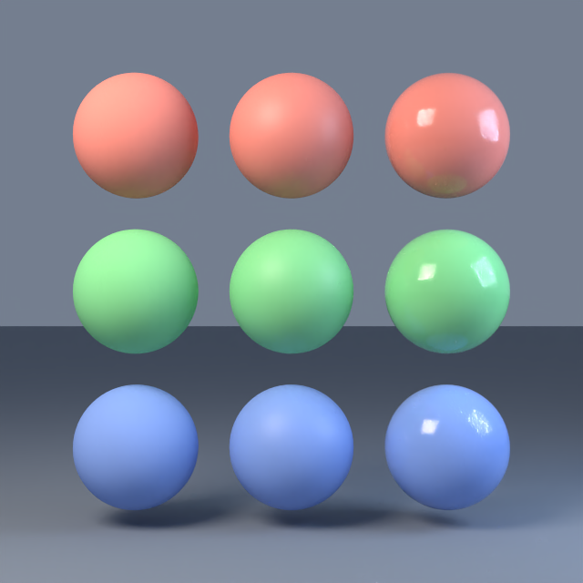 | 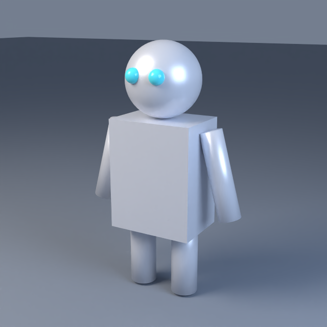 |
| Five gold spheres, roughness 0.05 to 0.95 (from lmmagnum and lmfilament)<br>`lmctl autorun https://raw.githubusercontent.com/lmctl-ai/lmblender/main/examples/pbr-spheres.lms` | Colour by gloss grid (from lmmagnum and lmfilament)<br>`lmctl autorun https://raw.githubusercontent.com/lmctl-ai/lmblender/main/examples/material-sandbox.lms` | A posed toy robot from primitives (from lmmagnum and lmfilament)<br>`lmctl autorun https://raw.githubusercontent.com/lmctl-ai/lmblender/main/examples/model-viewer.lms` |

| 3D text | Shadows | Multi draw |
| --- | --- | --- |
| 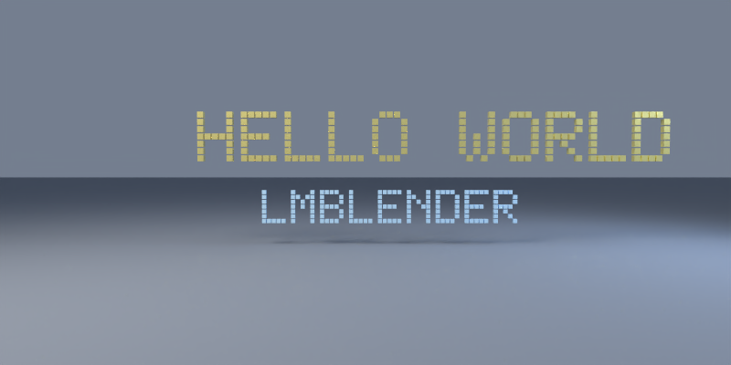 | 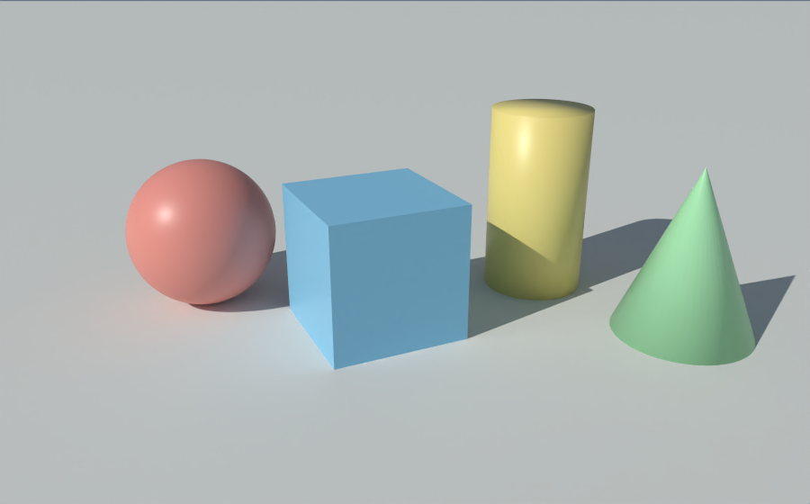 | 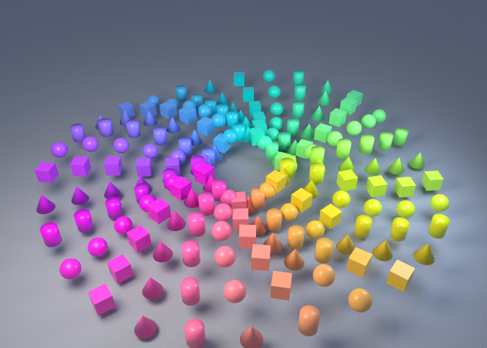 |
| Two lines with scene.label (from lmmagnum and lmfilament)<br>`lmctl autorun https://raw.githubusercontent.com/lmctl-ai/lmblender/main/examples/text.lms` | Floor and four solids lit by a sun (from lmmagnum and lmfilament)<br>`lmctl autorun https://raw.githubusercontent.com/lmctl-ai/lmblender/main/examples/shadows.lms` | 180 meshes in six rings (from lmmagnum and lmfilament)<br>`lmctl autorun https://raw.githubusercontent.com/lmctl-ai/lmblender/main/examples/multidraw.lms` |

| Sky in mirror spheres | Falling boxes | 3D flow streamlines |
| --- | --- | --- |
| 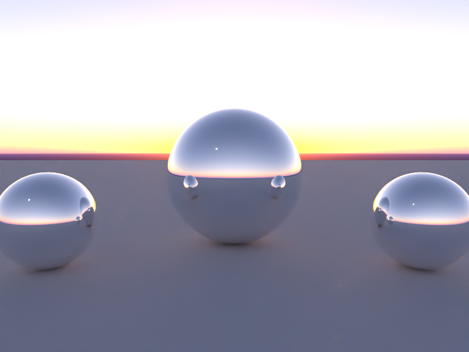 | 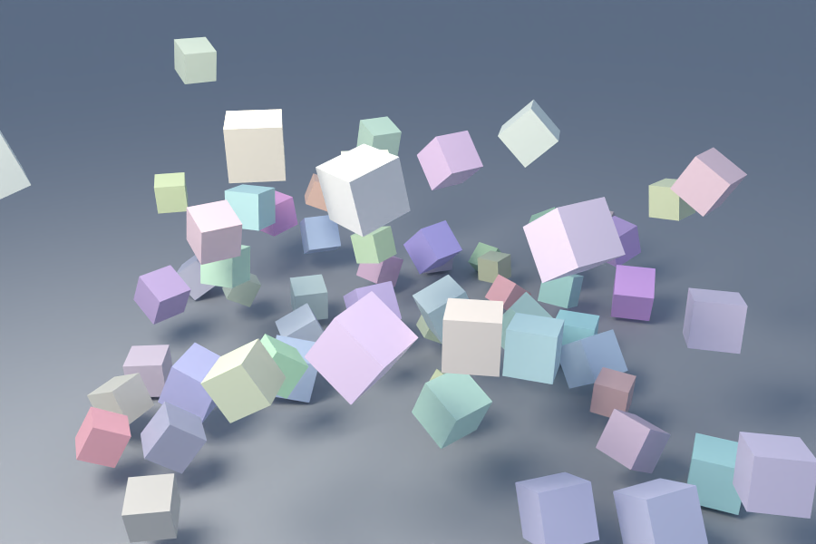 | 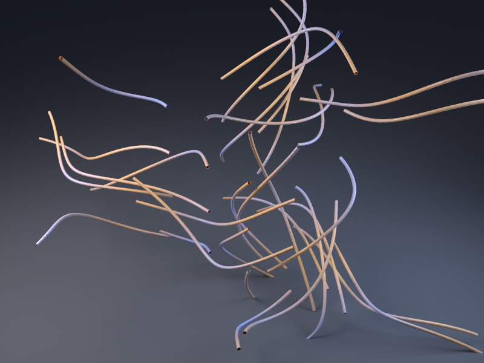 |
| A procedural sky as the cube map, reflected by three mirror spheres (from lmmagnum and lmfilament)<br>`lmctl autorun https://raw.githubusercontent.com/lmctl-ai/lmblender/main/examples/cubemap.lms` | 64 boxes with closed-form fall and bounce, no engine (from lmmagnum and lmfilament)<br>`lmctl autorun https://raw.githubusercontent.com/lmctl-ai/lmblender/main/examples/bullet.lms` | 32 ABC-flow streamlines coloured by speed (from lmmagnum and lmfilament)<br>`lmctl autorun https://raw.githubusercontent.com/lmctl-ai/lmblender/main/examples/fluidsimulation3d.lms` |

| 2D vortex pair |   |   |
| --- | --- | --- |
| 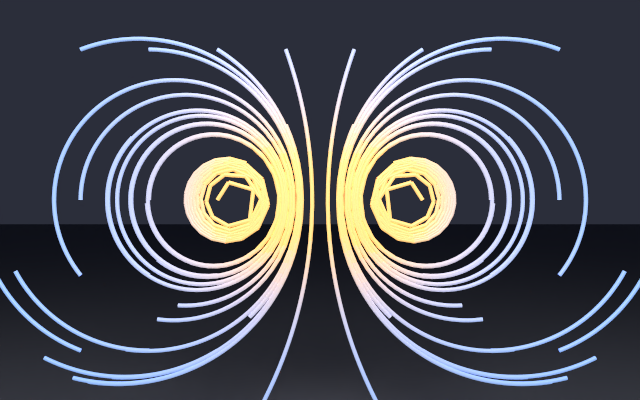 |   |   |
| 40 emissive streamlines of two opposite vortices (from lmmagnum and lmfilament)<br>`lmctl autorun https://raw.githubusercontent.com/lmctl-ai/lmblender/main/examples/fluidsimulation2d.lms` |   |   |

### Homepage clips from lmctl.com

The four 10 s clips on the [lmctl.com](https://lmctl.com) homepage, one per level of the agent-automation ladder. Their scene scripts live in [lmctl-ai/lmctl](https://github.com/lmctl-ai/lmctl/tree/main/scripts/homepage/video); the published videos add lmdraw title and label overlays on top of the 3D scenes shown here. Each example writes 240 frames, then ffmpeg encodes `images/<name>.mp4` and `.gif`; the lmblender version is the published Cycles storyboard at 640x360 with the draft preset.

| Level 1: names and teams | Level 2: agents talk through a Lead |
| --- | --- |
| 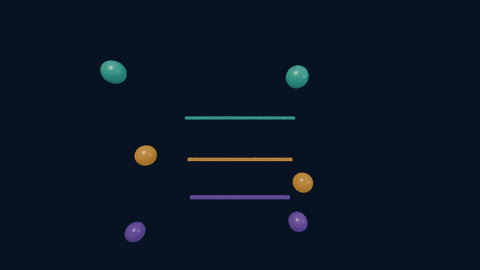 | 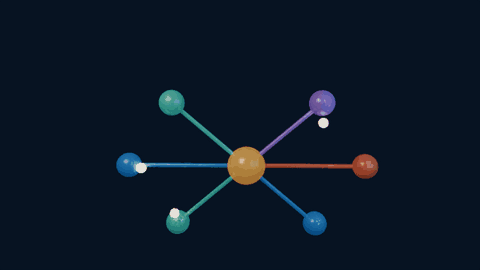 |
| Sessions gather into Lead, Coder and Review rows; a lens inspects one and a usage gauge rises<br>`lmctl autorun https://raw.githubusercontent.com/lmctl-ai/lmblender/main/examples/level-1-sessions.lms`<br>[MP4](docs/videos/level-1-sessions.mp4) | Provider-coloured agents orbit the Lead; message packets travel through it<br>`lmctl autorun https://raw.githubusercontent.com/lmctl-ai/lmblender/main/examples/level-2-orchestration.lms`<br>[MP4](docs/videos/level-2-orchestration.mp4) |

| Level 3: a hands-off Lead | Level 4: automation |
| --- | --- |
| 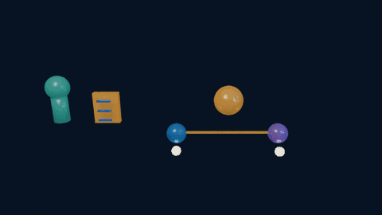 | 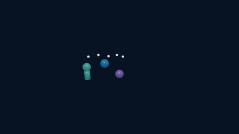 |
| A requirement and its checklist enter; a reviewed result returns<br>`lmctl autorun https://raw.githubusercontent.com/lmctl-ai/lmblender/main/examples/level-3-hands-off-lead.lms`<br>[MP4](docs/videos/level-3-hands-off-lead.mp4) | A brainstorm becomes a Work, Review, QA and Acceptance pipeline<br>`lmctl autorun https://raw.githubusercontent.com/lmctl-ai/lmblender/main/examples/level-4-automation.lms`<br>[MP4](docs/videos/level-4-automation.mp4) |

## Quick start (one minute)

```sh
npm install -g @lmctl-ai/lmctl
lmctl autorun https://raw.githubusercontent.com/lmctl-ai/lmblender/main/examples/cornell-box.lms
```

That downloads the example, compiles its scene to DSL bytecode, fetches the lmblender release for your OS (Linux x64/arm64, macOS x64/arm64, Windows x64) and writes `images/cornell-box.png`. To write your own scene, save this as `hello.lms` and run `lmscript hello.lms`:

```lmscript
out = "build/hello.dslb";
mkdir("images");
mkdir("build");
p = _lmcode_ cli="lmblender" install="github:lmctl-ai/lmblender@latest";
let ball = scene.uv_sphere(1.0, 48, 32, true);
ball.set_material(scene.material(0.1, 0.3, 0.8, 0.0, 0.25, 0.0, 0.0, 0.0, 0.0, 0.0));
scene.studio_setup();
scene.render_png("images/hello.png", 32, 640, 480);
end _lmcode_
savedsl(p, out);
argv = dsl_cli(p);
push(argv, "--dsl");
push(argv, out);
r = system(argv, 3600000);
println(trim(r.stdout));
if (r.code != 0) { println(trim(f"lmblender exit {r.code}: {r.stderr}")); exit(1); }
println("wrote images/hello.png");
```

- [Tutorial](docs/tutorial/index.md): ten short steps from one sphere to imported meshes, animation, and error handling.
- [DSL guide](docs/LLM_GUIDE.md): every scene call with units, bounds, and error codes (`lmblender --dsl-schema` prints the same list).
- [Compared with Blender](docs/tutorial/11-compare-with-blender.md): 44 examples rendered by lmblender and by Blender 5.2, side by side.
- `examples/render-all.sh` re-renders every gallery image into `docs/images/`.

## More examples

The other programs in [examples/](examples/) are feature demonstrations and regression scenes (materials, lights, cameras, imports, passes, presets, animation). They also self-execute and write into `images/`, but the import, texture and preset ones read fixtures from `tests/fixtures/`, so run them from a clone (`lmscript examples/<name>.lms`) rather than from a URL. `examples/video/run.sh` renders four short diagram clips; `examples/compose/run.sh` and `examples/bridge/run.sh` are lmcad and BlenderCLI pipelines.

## Limits

- CPU only. A 900×560 frame at 32–64 samples with OIDN denoising takes roughly 5–30 s on four cores; the 1280×720, 64-sample studio frame in `examples/video/throughput.lms` took 49.9 s on a four-core aarch64 host ([THROUGHPUT.md](docs/THROUGHPUT.md)).
- Point, area, spot and sun lamps light surfaces directly but are not hit by reflected or refracted rays, so they do not show up in mirrors or glass and cannot make caustics. Use an emissive mesh (a thin `cube` or `cylinder` with an emission material) when a lamp must be seen in a reflection or focused by glass, as the caustic, gear and Cornell examples do.
- `scene.material` has no IOR parameter (glass uses Cycles' default 1.5), `label` text is uppercase letters and spaces only, and hair is swept mesh geometry, not Cycles curves.
- Imports: OBJ/MTL, STL, ASCII PLY and glTF 2.0 triangles; binary PLY, embedded glTF images, skinning and morph targets are rejected with structured errors.
- Animation keys cover mesh translation and visibility, camera, material colour/emission and point-light strength; mesh rotation is not animated.

## License

The combined static executable is distributed under **GPL-3.0-or-later** because it links GPL Blender intern code (sky model, guarded allocator, libc compatibility). Cycles, OpenImageDenoise and Embree are Apache-2.0; OpenImageIO, OpenColorIO, OpenEXR and the other bundled libraries keep their own permissive licenses ([THIRD_PARTY_NOTICES.md](THIRD_PARTY_NOTICES.md), texts in [licenses/](licenses/)). Project-authored files are separately marked MIT where noted, including every example program. Every release ships its complete corresponding source as `lmblender-source-vX.Y.Z.tar.gz` ([SOURCE_OFFER.md](SOURCE_OFFER.md)); see also [the license audit](docs/LICENSE_AUDIT.md) and [relinking guide](docs/RELINKING.md).

`lmblender` is a standalone CPU Cycles renderer controlled by lmscript DSL bytecode. It is a separate executable from [lmcad](https://github.com/lmctl-ai/lmcad); composition happens through files and lmscript programs (see the gear example). The host embeds the pinned DSL v5 VM and schema. Blender's standalone Cycles source is built separately, without Blender, Python, GUI, or GPU backends.

## Current milestone status

| Area | Status | Current support / gap |
| --- | --- | --- |
| CPU Cycles render | Done | Static executable, direct C++ scene construction, PNG and EXR, CPU OIDN denoise |
| Materials and lights | Partial | Principled, checker/noise/ramp/bump, tangent normal + roughness/metallic/AO image maps, factor/texture closure mixing, optional backface transparency, emission, and point/sun/spot/rect/disk/ellipse lights (spot blend 0..1); glass, subsurface, and volume have numeric regressions; arbitrary node graphs remain unsupported |
| World | Partial | Color background, Cycles multiple-scattering sky, and equirectangular PNG/EXR/HDR environment node with rotation/strength |
| Camera and motion | Partial | Perspective/orthographic, look-at/fitting, Cycles aperture/focus DOF, and nine-sample shutter blur from keyed mesh translations and camera transforms (0.1–2 frame shutter) |
| Animation | Partial | Keyed mesh translation, camera position/target, and material base color with linear/ease interpolation; deterministic PNG sequences, atomic APNG (rational 1/fps delay), and temporal-sample motion blur; mesh rotation/scale and other material parameters remain unsupported |
| Mesh input | Partial | OBJ with bounded MTL materials, per-face `usemtl`, UVs/normals, diffuse/specular/roughness/alpha/emission and confined PNG/JPEG/EXR color/bump/opacity maps; STL, ASCII PLY, and glTF 2.0 JSON/GLB triangle meshes with node transforms and PBR factors/textures. Meshes support bounded baked X/Y/Z rotations for rigid-body presentation. Binary PLY and embedded glTF images remain unsupported |
| Diagram strands | Partial | Explicit tapered `strand` polylines and deterministic `hair_patch`/`hair_sphere` emitters produce swept meshes with materials; native Cycles hair primitives and photoreal fur grooming remain unsupported |
| Toon and loft | Partial | `toon_outline` strokes boundary/sharp mesh edges; `loft` sweeps a bounded convex profile along a polyline. Smooth-surface silhouette detection and arbitrary concave profiles are not supported |
| Gallery QA | Partial | The 12 README story renders run in `test.sh` with size, exposure and contrast gates (plus effect checks for the skin and Cornell scenes); 19 named 640×480 feature renders have numeric checks; four 640×360 video samples are checked separately; lmcad compositions are checked by their runner |
| Alpha output | Partial | Transparent world film emits RGBA PNG; shadow-catcher composition remains |

## Video examples

`examples/video/` contains four one-second visual language samples for agent teams, message routing, human-to-result flow, and a checked pipeline. Run `examples/video/run.sh` for 24-frame 24 fps PNG sequences and optional MP4s. See its [scene and QA notes](examples/video/README.md). The custom font is a simple extruded 5×7 uppercase ASCII mesh; visual effects are geometry and emission, with no bloom post-process.

## Using from another project

The `_dsl_ cli="lmblender" install="github:lmctl-ai/lmblender@latest"` declaration is the recommended install path; lmscript resolves the newest non-draft release and refreshes a cached binary when its `--version` changes. Use an exact tag such as `@v0.3.4` for reproducibility or a fixed offline cache. A matching binary already on `PATH` takes precedence. See [the consumer guide](docs/USING_FROM_POC.md). For local work, put the build output on `PATH`. `scripts/release.sh` also refreshes a relocatable `bin/`, `schema/`, `docs/`, and `examples/` layout; override its destination with `LMBLENDER_HOST_RELEASE`. It writes exact-name host binaries and checksums beside versioned tarballs under `dist/`.

For latest-release and pinned installation patterns, see [Using lmblender from another project](docs/USING_FROM_POC.md).

## BlenderCLI interchange

The paired [bridge example](examples/bridge/README.md) creates a multi-object
`.blend` scene through BlenderCLI worker operations, exports GLB with PBR factors
and emissive strength, then imports and renders the file with lmblender. Rendering the
same lmblender scene with Blender 5.2 ([tests/bridge_matched_reference.py](tests/bridge_matched_reference.py))
gives silhouette IoU `0.9989` (gate >0.98) and common-mask RGB MAD `0.86/255` (gate <4). Against
BlenderCLI's own render, which uses a different rig and view transform, only the silhouette is gated
(>0.92). Camera, lights, world, and parent hierarchy are currently recreated or
flattened by the example rather than transferred. Native Cycles curve hair is
also not imported; the [strand showcase](examples/strands-showcase.lms) uses
bounded swept-tube meshes and its numeric pixel checks.

## Scene API notes

- The static DSL host exposes `scene.version()`, `scene.import_obj(path)`, `scene.import_stl(path)`, `scene.import_ply(path)`, and `scene.import_gltf(path)`. PLY currently accepts bounded ASCII 1.0 meshes with x/y/z vertices and polygon face indices. glTF 2.0 `.gltf` and `.glb` import traverses the selected scene hierarchy, bakes node transforms into render meshes, preserves TEXCOORD_0, reads metallic/roughness and baseColorFactor, and supports external PNG/JPEG base-color images confined to the glTF directory. Imported meshes expose vertex/triangle counts and bounds. Sparse accessors, non-triangle modes, required extensions, skinning, morph targets, and embedded/data-URI images are rejected with structured glTF errors. Inputs are bounded to 256 MiB glTF containers, 512 MiB aggregate buffers, 64 MiB per texture, 10 million decoded vertices, 20 million triangles, 4096 generated meshes/materials, and 200,000 hierarchy visits. `scene.render_png(path, samples, width, height)` builds Cycles `Scene`, `Mesh`, `Object`, `ShaderGraph`, camera, and light nodes directly through the Cycles C++ API and renders them with an in-process CPU session. The renderer uses a fitted Z-up perspective camera by default, and assigns Cycles emission shaders to direct-light nodes so they participate in the light manager.
- OBJ import recognizes `mtllib`/`usemtl`, positive and negative face indices, corner UVs/normals, and MTL `Kd`, `Ks`, `Ns`, `d`/`Tr`, `Ke`, `map_Kd`, `map_Bump` (including `-bm`), and `map_d`. MTL paths are confined to the OBJ directory and require regular bounded files; other texture directives return `OBJ_MTL_UNSUPPORTED`. `Mesh.material_count()` reports the used material slots. The importer caps OBJ at 256 MiB, each MTL at 4 MiB, 16 MiB total MTL data, each texture at 64 MiB, and all referenced textures at 256 MiB. LMCAD's current OBJ exporter writes geometry/groups only (`o`, `v`, `f`), so its exports retain the scene-assigned material path.
- `scene.render_preset("draft"|"final")` is the legacy 8-spp/no-denoise or 64-spp/high-OIDN quality tier. For homepage diagrams, prefer `scene.use_preset("diagram-dark-16x9-draft")` (960x540, 8 spp, about 0.41 s/frame) or `scene.use_preset("diagram-dark-16x9-final")` (1280x720, 16 spp, fast CPU OIDN, about 2.00 s/frame for a simple emissive scene). Pass `0` as samples to use the preset sample count; render dimensions are still passed to `render_png`/`render_sequence`. `scene.denoise_quality("fast"|"balanced"|"high")` chooses the OIDN quality preset. The measured 16-spp fast vs 256-spp high reference is 47.14 dB PSNR / 0.99451 SSIM on a lit glossy test scene. Rendering uses four host CPU threads by default; call `scene.set_threads(n)` to override. Sequences still create a Cycles session for each frame; setup/BVH is below 1 ms in the measured small scenes. See [docs/THROUGHPUT.md](docs/THROUGHPUT.md) and the [OIDN CPU audit](docs/OIDN_AUDIT.md): optimized NEON kernels and four-thread OIDN were confirmed, and the historical 6.31 s OIDN measurement did not reproduce (controlled 960x540 rerun: 0.91 s). The glossy-scene no-denoise 64/128 spp alternatives were slower and missed the SSIM gate.
- Animation keys use absolute scene-space mesh translations (renderer units, Z up); additive `Mesh.translate` establishes the initial authored position before keys replace it. Sequences also sample keyed visibility, camera position/target and optics, material color/emission, and point-light strength. The regression example `examples/animation-visibility-optics.lms` checks pixels for all three cases.
- `scene.material(r, g, b, metallic, roughness, transmission, emission_r, emission_g, emission_b, emission_strength)` creates a Principled BSDF material. `scene.checker_material(...)`, `scene.noise_material(...)`, and `scene.ramp_material(...)` connect Cycles procedural nodes into Principled base color; `material.bump(strength, distance, scale)` adds a Noise → Bump normal network. `scene.image_material(path, roughness)` loads a PNG/JPEG/EXR via the static OIIO path, uses per-corner cube-projected UV coordinates, and caps the input at 64 MiB; PNG has a real-render regression fixture. Attach any with `mesh.set_material(material)`. Authored UVs from glTF `TEXCOORD_0` and OBJ `vt` drive image textures; meshes without UVs get a per-corner cube projection. Explicit texture color-space controls remain planned.
- Lighting bindings include `scene.world_color(r, g, b, strength)`, point, area, sun, and spot lights. `scene.sky_texture(elevation_degrees, rotation_degrees, intensity)` uses Cycles' multiple-scattering sky node as a world background; `examples/sky-texture.lms` checks the vertical luminance gradient and clipped-pixel ratio. `scene.environment_texture(path, rotation_degrees, strength)` loads bounded equirectangular PNG/EXR/HDR maps into a Cycles environment node. `scene.area_light_shape(..., size_x, size_y, "rectangle"|"disk"|"ellipse")` selects Cycles area emitter shapes; spot cone softness is controlled by `scene.spot_light(..., angle_degrees, blend)` with blend in [0,1]. Ground/backdrop helpers and aspect-aware fitted camera are also provided.
- `scene.camera_look_at(px, py, pz, tx, ty, tz, fov_degrees)` sets perspective with **vertical FOV**. `scene.camera_orthographic(px, py, pz, tx, ty, tz, vertical_span)` sets the visible vertical scene-unit span. Camera projection compensates the horizontal basis for output pixel aspect, so spheres and squares remain isotropic in landscape, square, and portrait renders, including `render_sequence`. Panoramic projections and camera instancing remain unsupported.
- `scene.studio_setup()` is a one-call imported-model presentation helper: it uses transformed geometry bounds for camera fit and floor height, then adds neutral world fill, a matte floor, and warm key/cool fill/rim area lights. Apply any source axis conversion before calling it; STL has no unit or up-axis metadata.
- Render inputs are bounded to 65,536 samples, 4096x4096 dimensions and 16 million pixels, 10 million vertices per mesh, 20 million triangles total, 4096 imported meshes/materials, and 1024 point lights. `scene.render_timeout(seconds)` sets the Cycles session wall-clock limit (1–3600 seconds; default 3600); timeout cancels the render, removes its staged PNG, and returns structured `RENDER_TIMEOUT` JSON. The whole program is additionally bounded by `LMBLENDER_RUN_TIMEOUT_SECONDS` (default 7200) and `LMBLENDER_MAX_INSTRUCTIONS` (default 100 million), scene geometry by a 10M-vertex/20M-triangle budget, decoded images by 64 megapixels, and `LMBLENDER_OUTPUT_ROOT=<dir>` confines every output path to one directory (symlinked output directories are always refused). The timeout regression deliberately cancels a 1024-square 65,536-sample render after one second.
- `scene.render_settings(max_bounces, seed, denoise)` exposes Cycles bounce depth, sampling seed, and CPU OIDN denoising. Denoising is available when Cycles is configured with `WITH_OPENIMAGEDENOISE=ON`; no GPU backend is built. Bounds are 0–64 bounces and a seed in 0..2147483647.
- Run `./examples/compose/run.sh` for lmcad-to-lmblender STL composition examples. It exports a mug, plate with holes, and U-channel bracket from lmcad, then renders the bracket from three static camera views and eight-angle mug/bracket turntable sets. STL carries tessellated geometry only; the renderer applies materials after import and assumes source coordinates use Cycles world units. Numeric turntable QA is in `tests/turntable_quality.py`; composition review notes are in `docs/MILESTONE3-QA.md`.
- `scene.render_exr(path, samples, width, height)` writes a linear 32-bit-float OpenEXR. `scene.render_passes(prefix, samples, width, height)` enables Cycles Combined, Z, Normal, and Diffuse Color (reported as albedo), writing each as a separate EXR plus a normalized PNG (`prefix-{combined,depth,normal,albedo}.{exr,png}`). Depth PNG maps near/far to white/black, normal PNG maps [-1,1] to [0,1], and combined PNG uses AgX. A Blender-backed regression checks monotonic depth across a ramp, unit normals, channel counts, and all eight outputs.
- `scene.set_view_transform(name)` selects `Standard`, `Filmic`, or `AgX` for PNG output. Standard is the exact sRGB transfer function with clipping. Filmic and AgX use 33³ RGB LUTs baked from Blender 5.2's OCIO config on a log1p(64 v) shaper ([tools/generate_view_luts.py](tools/generate_view_luts.py)), interpolated trilinearly; against OCIO itself the mean error is about 0.1 to 0.2/255 and dark tones are no longer crushed. No OCIO runtime library or config is loaded. Values above scene-linear 16 are clamped. `test.sh` renders a neutral emission panel with both lmblender and Blender, then checks each transform's center-pixel RGB RMSE is at most 3/255 (currently 0.59, 0.69, and 0.60/255). EXR remains scene-linear.
- `mesh.translate(dx, dy, dz)`, `mesh.scale(sx, sy, sz)`, and `mesh.rotate_x/y/z(degrees)` set authored transforms; rotations are baked into vertices and explicit corner normals and can orient rigid-body parts around any world axis. Rotate a source before `scene.instance_mesh(mesh, x, y, z, sx, sy, sz)`; instances reject direct rotation because they share source geometry. glTF scene-node transforms are currently baked into each generated render mesh; general DSL object instances use shared geometry.
- `scene.image_material(path, roughness)` loads a bounded PNG/JPEG/EXR through Cycles' image-texture node. The current fixture verifies PNG decoding and cube-projected UVs; PNG/JPEG color images are decoded from sRGB and EXR/HDR read as scene-linear (the host runs Cycles without an OCIO config, so it tags them explicitly); JPEG and EXR input fixtures and per-image colorspace overrides remain open. Input files are limited to 64 MiB.
- A standalone static Cycles executable has been built at `build/cycles-static/bin/cycles` on the development host. It renders XML scenes to PNG with no `LD_LIBRARY_PATH` or `OCIO` environment and passes the `ldd: not a dynamic executable` check.
- A Cornell-box-style XML smoke scene rendered identically with static and dynamic Cycles at 128x128 and 16 samples (RGB MAD 0/255). The fixture uses emissive room panels and a blue box to check geometry/XML/image output; it is not a lighting parity fixture.
- OBJ/STL mesh handles render without launching another process. Production rendering uses the Cycles C++ node API; the XML reader is only a test oracle. Separate depth/normal/albedo passes are implemented. CPU denoising is linked through static OIDN archives and covered by the quality regression described below.

## Named presentation presets

`lmblender --presets` lists six embedded, versioned looks; `lmblender --preset-show product-studio` prints one preset as JSON. In DSL, call `scene.use_preset("product-studio")` after adding the geometry to auto-frame it, then use `scene.material_from_palette("accent")`. Explicit settings called afterward take precedence. External version-1 JSON presets use `scene.load_preset(path)`. See [the preset guide](docs/PRESETS.md) and [LLM DSL guide](docs/LLM_GUIDE.md).

## Build and test

The scripts below build host-specific dependencies and Cycles from Blender's source checkout without changing that checkout. GCC 14 is used to match the existing Blender build.

```sh
./scripts/sync-sdk.sh --verify
./test.sh
BUILD_JOBS=2 LMBLENDER_STATIC_PREFIX="$PWD/build/static-prefix-gcc14" \
  LMBLENDER_DEPS_BUILD_DIR="$PWD/build/deps-gcc14" ./scripts/build-deps.sh
BUILD_JOBS=2 ./scripts/build-oidn-static.sh
BUILD_JOBS=2 LMBLENDER_STATIC_PREFIX="$PWD/build/static-prefix-gcc14" \
  LMBLENDER_DEPS_BUILD_DIR="$PWD/build/deps-gcc14" ./scripts/configure-cycles-static.sh
./tests/static-cycles-smoke.sh
ldd build/lmblender
ldd build/cycles-static/bin/cycles
```

`build-deps.sh` builds static TBB, Embree 4.4.1, Imath, OpenEXR, TIFF, OpenColorIO, and OpenImageIO. `configure-cycles-static.sh` configures standalone Cycles with CPU Embree and OIDN enabled, and Blender integration, Python, GUI/GPU, OpenVDB, OpenSubdiv, OSL, USD, and Hydra disabled. It uses a build-only source overlay with a placeholder for the unavailable Git LFS `startup.blend`; the Blender source checkout remains clean.

The standalone Cycles ELF is fully static according to `file` and `ldd` (88,386,432 bytes in the measured arm64 Embree build). GNU ld warns that static glibc `getpwuid` and OIIO's plugin loader `dlopen` need shared libraries if those code paths are used. The verified PNG render works with `LD_LIBRARY_PATH` and `OCIO` unset; plugin loading beyond that path has not been tested.

The lmblender host and Cycles executable are statically linked (`ldd` reports “not a dynamic executable”). The measured arm64 host binary with Embree is 90,415,296 bytes (86.2 MiB); `lmblender --version` reports Cycles 4.5.0 and OpenImageDenoise 2.5.0. [THROUGHPUT.md](docs/THROUGHPUT.md) records the BVH2 speed, image, and size comparison. With static CPU OIDN enabled, the denoise regression renders a four-sample noisy image, the same scene with denoising, and a 64-sample reference: high-frequency residual falls from 4.040 to 0.832, silhouette IoU against reference is 0.9797, and median edge gradient is 21.57 versus 16.43 (76% retained). `./test.sh` checks schema embedding, mesh/glTF imports, numeric rendering examples, display transforms, passes, and denoising. `./scripts/full-check.sh` adds the static-linkage, 640×480 image, and per-image QA gates and records its latest result to `docs/STATUS.md`.

`scripts/build-oidn-static.sh` builds OIDN 2.5 CPU archives with CUDA/HIP/SYCL disabled. `scripts/configure-cycles-static.sh` adapts OIDN 2.x archive names for Blender's legacy CMake finder, configures CPU OIDN and rebuilds Cycles. The host links the same static archives. Static glibc emits a warning about OIDN's module-loader `dlopen` path; the exercised CPU filter works without shared libraries. `tests/denoise_quality.py` uses an auditable residual, silhouette, and edge-gradient comparison.

See [docs/LLM_GUIDE.md](docs/LLM_GUIDE.md) for the complete DSL signature list, parameter units, limits, recipes, and error recovery; [docs/ANIMATION.md](docs/ANIMATION.md) documents frame sequences and APNG limits.
The deterministic import/bytecode mutation corpus and ASan/UBSan replay commands are in [docs/ROBUSTNESS.md](docs/ROBUSTNESS.md).

## Dependencies

The VM and schema are pinned in `sdk.lock`; `scripts/sync-sdk.sh --verify` checks the vendored header against that pin. See [THIRD_PARTY_NOTICES.md](THIRD_PARTY_NOTICES.md) for notices.
