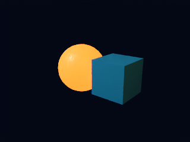
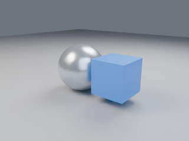
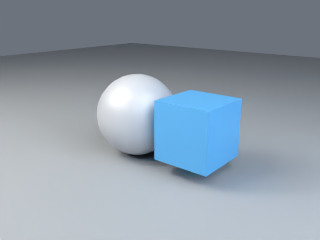
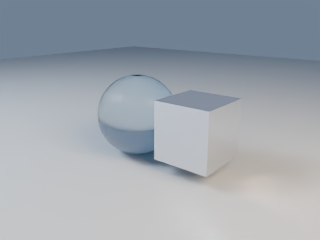
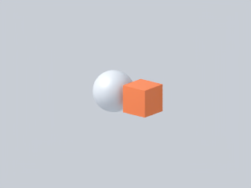

# Presentation presets

The catalog is declarative JSON embedded from `presets/presets.json` at build time. `lmblender --presets` lists names and descriptions; `lmblender --preset-show NAME` prints one resolved JSON definition. Embedded and external presets use catalog version 1. An external file may be a single preset object or an envelope shaped as `{ "version": 1, "preset": { ... } }`; `examples/presets/technical-clean.external.json` exercises the envelope.

| Name | Intended use | Defaults |
|---|---|---|
| `diagram-dark-16x9-draft` | Fast dark diagrams and motion graphics | 8 samples, 2 bounces, 960x540 metadata |
| `diagram-dark-16x9-final` | Denoised dark diagram final frames | 16 samples, 6 bounces, OIDN, 960x540 metadata |
| `product-studio` | Grounded product preview with three softboxes | AgX, ground, three area lights, OIDN |
| `turntable-neutral` | Neutral turntable preview | 8 samples, ground, fitted perspective |
| `glass-showcase` | Reflective/transmissive materials | AgX, ground, high-bounce OIDN |
| `technical-clean` | Neutral orthographic technical view | Orthographic, Standard transform, 8 samples |

Call `scene.use_preset(name)` or `scene.load_preset(path)` after creating scene geometry. The preset only removes and replaces elements it generated on the prior preset application; user geometry, materials, and lights remain. Generated lighting positions, ground size, and framing target scale from geometry bounds. Then make explicit overrides with normal scene APIs or `scene.preset_param(name,value)`. `scene.material_from_palette(name)` creates a material from the active palette.

Later explicit calls win. In particular, `camera_look_at(...)` and
`camera_orthographic(...)` disable preset auto-framing so the supplied camera
position/target/scale is used. `fit_camera(...)` explicitly re-enables geometry
framing. The first explicit light call after a preset (`point_light`,
`area_light`, `area_light_shape`, `sun_light`, or `spot_light`) removes the
preset-generated area-light rig; subsequent explicit lights add to the user's
own rig. User-authored lights added before selecting a preset are preserved.
`tests/preset-explicit-overrides.lms` renders before/after images and verifies
the changed camera mask and saturated green area-light response numerically.

A preset may set `camera.auto_frame` to `false`; it must then give `camera.position` (and optionally `camera.target`) in units of the scene radius relative to the geometry center, the same convention as its light positions, otherwise it is refused with `PRESET_INVALID`. `tests/presets/no-autoframe-position.json` is a minimal example.

`preset_param` accepts integer-valued `samples` (1..65536), `bounces` (0..64), and `threads` (1..64), plus `world_strength` (0..100), vertical `camera_fov_degrees` (5..170), and positive `orthographic_vertical_span` (up to 1,000,000 scene units). The render call continues to set output width/height; catalog resolution and fps are descriptive defaults for caller workflows and do not silently override an explicit output request.

Examples live in `examples/presets/`. `test.sh` renders every preset and verifies dimensions, occupied pixel coverage, image luminance range, CLI listing/show JSON, embedded schema, and DSL signature conformance. The scene examples use an explicit 16-sample denoised preview override so the images are readable while tests remain bounded; their numeric QA checks image bounds, chroma/contrast, and CLI catalog output. The catalog's final-quality settings are also inspected via `--preset-show`.

The homepage-video scripts use a dark navy world (`[0.008,0.016,0.040]`, strength `0.55`), 16 samples, 6 bounces, denoising, seed 17, and 960x540 previews. The final diagram preset follows those settings; draft remains an 8-sample/2-bounce fast iteration mode. A reply file asks whether the team wants the draft tier to use their slower denoised settings too.

## Preview thumbnails

The committed thumbnails were rendered by the matching `.lms` examples at 320x240 with 16 samples and denoising. `test.sh` regenerates the full-size build outputs and checks the same scene predicates.

- `diagram-dark-16x9-draft`: 
- `diagram-dark-16x9-final`: 
- `product-studio`: 
- `turntable-neutral`: 
- `glass-showcase`: 
- `technical-clean`: 
