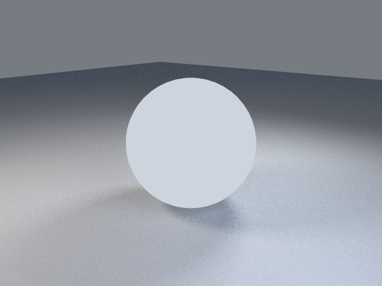

# 1. First render

Goal: confirm lmscript can download lmblender and render one image.

First check that lmscript is installed (see the [index](index.md) for the install command):

```sh
lmscript --version
```

It should print a version line such as `lmscript 0.2.388`.

Save this as `01-first-render.lms` in an empty directory, or download it:

```sh
curl -O https://raw.githubusercontent.com/lmctl-ai/lmblender/main/docs/tutorial/code/01-first-render.lms
```

<!-- code: code/01-first-render.lms -->
```lmscript
p = _dsl_ cli="lmblender" install="github:lmctl-ai/lmblender@latest";
let ball = scene.uv_sphere(1.0, 48, 24, true);
scene.studio_setup();
scene.render_png("first-render.png", 16, 640, 480);
end _dsl_
file = "first-render.dslb";
savedsl(p, file);
r = system ${dsl_cli(p)} --dsl ${file};
delete_file(file);
if (r.code != 0) { println(trim(r.stdout)); if (trim(r.stderr) != "") { println(trim(r.stderr)); } exit(1); }
println("wrote first-render.png");
```

Run it:

```sh
lmscript 01-first-render.lms
```

Expected output (the first run also downloads the lmblender release, so it takes longer):

```text
wrote first-render.png
```



What each part does:

- `p = _dsl_ cli="lmblender" install="..."` opens a block of scene code for the lmblender host. The `install=` value tells lmscript where to fetch the executable if it is not on your PATH; `@latest` follows the newest release, and a tag such as `@v0.3.4` pins one.
- `scene.uv_sphere(1.0, 48, 24, true)` adds a sphere of radius 1 with 48 segments and 24 rings, smooth shaded. Units are scene units and Z points up.
- `scene.studio_setup()` frames the camera on the geometry and adds a floor and three soft lights.
- `scene.render_png(path, samples, width, height)` renders with CPU Cycles. More samples means less grain and more time.
- After `end _dsl_`, `savedsl` writes the compiled bytecode, `system ${dsl_cli(p)} --dsl ${file}` runs lmblender on it, and the script prints the host's error and exits 1 if the render failed.

The sphere looks flat white because it has no material yet; meshes without one get a plain unlit surface. Page 3 adds real materials.

Next: [2. Camera](02-camera.md).
