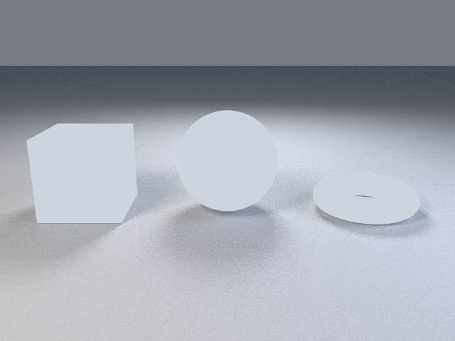

# 2. Camera

Goal: place several objects and choose the camera position yourself.

Building on page 1, this adds a cube and a torus, moves them with `translate`, keeps `studio_setup` for the floor and lights, and then sets the camera explicitly.

```sh
curl -O https://raw.githubusercontent.com/lmctl-ai/lmblender/main/docs/tutorial/code/02-camera.lms
```

<!-- code: code/02-camera.lms -->
```lmscript
p = _dsl_ cli="lmblender" install="github:lmctl-ai/lmblender@latest";
let ball = scene.uv_sphere(1.0, 48, 24, true);
let box = scene.cube(1.6);
box.translate(-2.8, 0.0, 0.0);
let ring = scene.torus(0.8, 0.25, 48, 16, true);
ring.translate(2.8, 0.0, 0.0);
scene.studio_setup();
scene.camera_look_at(0.0, -9.0, 3.0, 0.0, 0.0, 0.0, 40.0);
scene.render_png("camera.png", 16, 640, 480);
end _dsl_
file = "camera.dslb";
savedsl(p, file);
r = system ${dsl_cli(p)} --dsl ${file};
delete_file(file);
if (r.code != 0) { println(trim(r.stdout)); if (trim(r.stderr) != "") { println(trim(r.stderr)); } exit(1); }
println("wrote camera.png");
```

```sh
lmscript 02-camera.lms
```

Expected output:

```text
wrote camera.png
```



- `translate(dx, dy, dz)` moves a mesh; +X is right and +Y points away from the default view.
- `camera_look_at(px, py, pz, tx, ty, tz, fov)` puts the camera at the first point, aims it at the second, and uses a vertical field of view in degrees. Here the camera is 9 units in front of the objects and 3 units up.
- A camera call made after `studio_setup` replaces its automatic framing; the floor and lights stay.

Two things in this image are expected. The shapes are centered on Z = 0 and `studio_setup` places its floor a little below the lowest point, so they float with their shadows underneath; page 3 raises them onto a ground plane. And without materials the shapes are flat and unlit, so the torus reads as a plain ellipse with no visible hole; page 3 fixes that too.

Always set a camera (or call `studio_setup` or `fit_camera`). Without one, lmblender uses a fallback view that is noticeably squeezed horizontally in non-square images; see [page 9](09-compare-with-blender.md).

Next: [3. Materials and lights](03-materials-and-lights.md).
