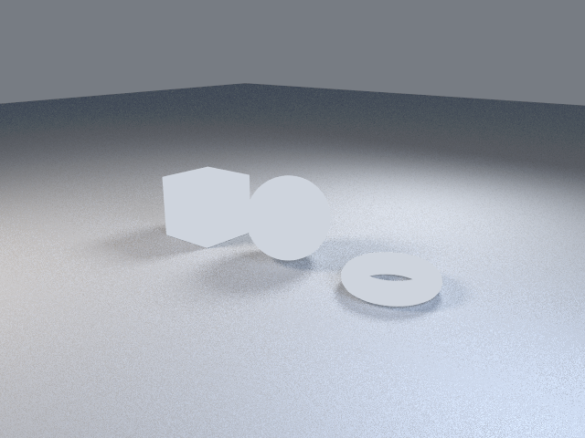

# 2. Place objects

Goal: put several objects in the scene where you want them.

Page 1 had one sphere at the origin. This page adds a cube and a torus and moves each object with `translate` so that it rests on the ground at Z = 0.

Download the full script, or copy it from below:

```sh
curl -O https://raw.githubusercontent.com/lmctl-ai/lmblender/main/docs/tutorial/code/02-place-objects.lms
```

<!-- code: code/02-place-objects.lms -->
```lmscript
p = _lmcode_ cli="lmblender" install="github:lmctl-ai/lmblender@latest";
let ball = scene.uv_sphere(1.0, 48, 24, true);
ball.translate(0.0, 0.0, 1.0);
let box = scene.cube(1.6);
box.translate(-2.8, 0.0, 0.8);
let ring = scene.torus(0.8, 0.25, 48, 16, true);
ring.translate(2.8, 0.0, 0.25);
scene.studio_setup();
scene.render_png("place-objects.png", 16, 640, 480);
end _lmcode_
file = "place-objects.dslb";
savedsl(p, file);
argv = dsl_cli(p);
push(argv, "--lmcode");
push(argv, file);
r = system(argv, 3600000);
println(trim(r.stdout));
delete_file(file);
if (r.code != 0) { println(trim(f"lmblender exit {r.code}: {r.stderr}")); exit(1); }
println("wrote place-objects.png");
```

Run it:

```sh
lmscript 02-place-objects.lms
```

Expected output:

```text
{"ok": true, "result": null}
wrote place-objects.png
```



- `translate(dx, dy, dz)` moves a mesh. +X is right, +Y points away from the viewer, +Z is up.
- Primitives are centered on their origin, so a sphere of radius 1 is raised by 1, a cube of size 1.6 by 0.8, and the torus by its tube radius 0.25.
- `studio_setup()` places its floor at the lowest point of the geometry and frames everything, so all three objects stay in view.

The torus reads as a flat ring and the shapes are still unlit; pages 3 and 4 fix the view and the surfaces.

Next: [3. Camera](03-camera.md).
