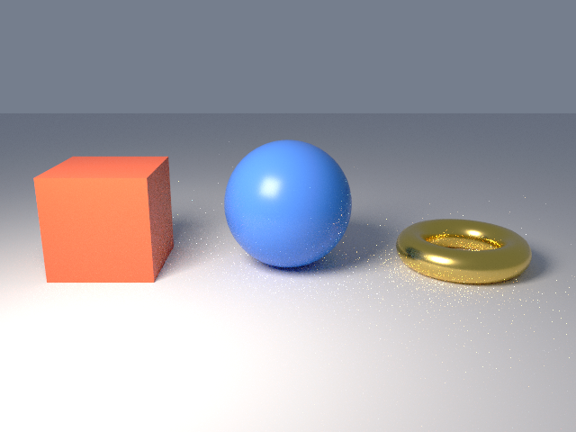

# 3. Materials and lights

Goal: give each object a material and light the scene yourself instead of using studio_setup.

The objects and camera are the same as page 2. The objects are raised so they rest on a ground plane at Z = 0, `studio_setup` is replaced by explicit world, ground, and light calls, and each mesh gets a material.

```sh
curl -O https://raw.githubusercontent.com/lmctl-ai/lmblender/main/docs/tutorial/code/03-materials-and-lights.lms
```

<!-- code: code/03-materials-and-lights.lms -->
```lmscript
p = _dsl_ cli="lmblender" install="github:lmctl-ai/lmblender@latest";
let ball = scene.uv_sphere(1.0, 48, 24, true);
ball.translate(0.0, 0.0, 1.0);
ball.set_material(scene.material(0.08, 0.25, 0.85, 0.0, 0.3, 0.0, 0.0, 0.0, 0.0, 0.0));
let box = scene.cube(1.6);
box.translate(-2.8, 0.0, 0.8);
box.set_material(scene.material(0.9, 0.15, 0.06, 0.0, 0.4, 0.0, 0.0, 0.0, 0.0, 0.0));
let ring = scene.torus(0.8, 0.25, 48, 16, true);
ring.translate(2.8, 0.0, 0.25);
ring.set_material(scene.material(0.95, 0.7, 0.2, 1.0, 0.25, 0.0, 0.0, 0.0, 0.0, 0.0));
scene.ground_plane(0.0, 20.0, 0.7, 0.7, 0.72);
scene.world_color(0.6, 0.7, 0.9, 0.3);
scene.area_light(-3.0, -4.0, 5.0, 0.0, 0.0, 1.0, 1.0, 0.92, 0.82, 600.0, 3.0);
scene.camera_look_at(0.0, -9.0, 3.5, 0.0, 0.0, 0.8, 40.0);
scene.render_png("materials-and-lights.png", 32, 640, 480);
end _dsl_
file = "materials-and-lights.dslb";
savedsl(p, file);
r = system ${dsl_cli(p)} --dsl ${file};
delete_file(file);
if (r.code != 0) { println(trim(r.stdout)); if (trim(r.stderr) != "") { println(trim(r.stderr)); } exit(1); }
println("wrote materials-and-lights.png");
```

```sh
lmscript 03-materials-and-lights.lms
```

Expected output:

```text
wrote materials-and-lights.png
```



`scene.material` takes ten numbers in this order:

1. base color red, green, blue (0 to 1, linear)
2. metallic (0 dielectric, 1 metal)
3. roughness (0 mirror, 1 matte)
4. transmission (1 for glass)
5. emission red, green, blue
6. emission strength (0 for none)

The gold torus is `metallic 1.0` with roughness 0.25.

- `ground_plane(z, half_size, r, g, b)` adds a matte floor.
- `world_color(r, g, b, strength)` sets the sky color, which also lights the scene softly.
- `area_light(x, y, z, tx, ty, tz, r, g, b, power, size)` adds a square light at the first point facing the second. Power is in watts, as in Blender.

The bright speckles on the floor around the torus and on the sphere are light bounced off the gold metal that 32 samples have not averaged out yet. Raising the sample count removes them at the cost of render time. `scene.render_settings(bounces, seed, true)` turns on the OIDN denoiser, but read the known issue on [page 8](08-when-it-fails.md) before you use it on Linux arm64.

Next: [4. Textures](04-textures.md).
