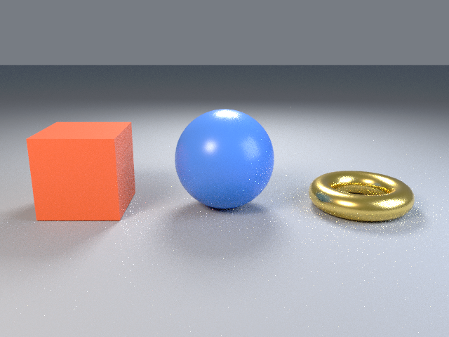

# 4. Materials

Goal: give each object a color and surface.

The script is page 3 plus three `set_material` lines, with the samples raised from 16 to 32 because shiny surfaces need more samples to look smooth.

Download the full script, or copy it from below:

```sh
curl -O https://raw.githubusercontent.com/lmctl-ai/lmblender/main/docs/tutorial/code/04-materials.lms
```

<!-- code: code/04-materials.lms -->
```lmscript
p = _lmcode_ cli="lmblender" install="github:lmctl-ai/lmblender@latest";
let ball = scene.uv_sphere(1.0, 48, 24, true);
ball.translate(0.0, 0.0, 1.0);
let box = scene.cube(1.6);
box.translate(-2.8, 0.0, 0.8);
let ring = scene.torus(0.8, 0.25, 48, 16, true);
ring.translate(2.8, 0.0, 0.25);
ball.set_material(scene.material(0.08, 0.25, 0.85, 0.0, 0.3, 0.0, 0.0, 0.0, 0.0, 0.0));
box.set_material(scene.material(0.9, 0.15, 0.06, 0.0, 0.4, 0.0, 0.0, 0.0, 0.0, 0.0));
ring.set_material(scene.material(0.95, 0.7, 0.2, 1.0, 0.25, 0.0, 0.0, 0.0, 0.0, 0.0));
scene.studio_setup();
scene.camera_look_at(0.0, -9.0, 3.5, 0.0, 0.0, 0.8, 40.0);
scene.render_png("materials.png", 32, 640, 480);
end _lmcode_
file = "materials.dslb";
savedsl(p, file);
argv = dsl_cli(p);
push(argv, "--dsl");
push(argv, file);
r = system(argv, 3600000);
println(trim(r.stdout));
delete_file(file);
if (r.code != 0) { println(trim(f"lmblender exit {r.code}: {r.stderr}")); exit(1); }
println("wrote materials.png");
```

Run it:

```sh
lmscript 04-materials.lms
```

Expected output:

```text
{"ok": true, "result": null}
wrote materials.png
```



`scene.material` takes ten numbers in this order:

1. base color red, green, blue (0 to 1, linear)
2. metallic (0 dielectric, 1 metal)
3. roughness (0 mirror, 1 matte)
4. transmission (1 for glass)
5. emission red, green, blue
6. emission strength (0 for none)

The gold torus is metallic 1.0 with roughness 0.25; the cube and sphere are dielectric. `set_material` assigns a material to one mesh, and one material can be shared by several meshes.

Next: [5. Lights](05-lights.md).
