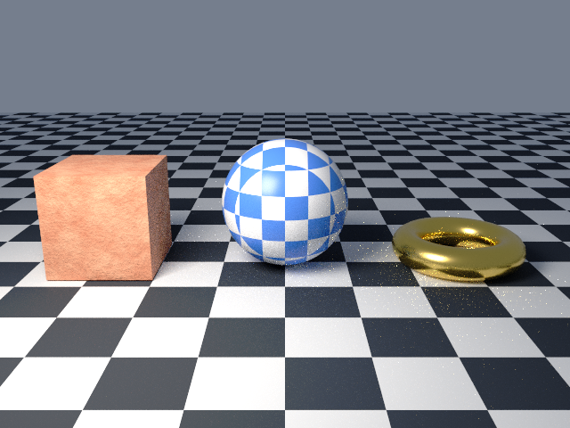

# 6. Textures

Goal: replace flat colors with procedural textures and surface bump.

The script is page 5 with two materials changed: the sphere becomes a checker, and the cube becomes noise with bump. The ground plane becomes a checker floor.

Download the full script, or copy it from below:

```sh
curl -O https://raw.githubusercontent.com/lmctl-ai/lmblender/main/docs/tutorial/code/06-textures.lms
```

<!-- code: code/06-textures.lms -->
```lmscript
p = _dsl_ cli="lmblender" install="github:lmctl-ai/lmblender@latest";
let ball = scene.uv_sphere(1.0, 48, 24, true);
ball.translate(0.0, 0.0, 1.0);
let box = scene.cube(1.6);
box.translate(-2.8, 0.0, 0.8);
let ring = scene.torus(0.8, 0.25, 48, 16, true);
ring.translate(2.8, 0.0, 0.25);
ball.set_material(scene.checker_material(0.08, 0.25, 0.85, 0.9, 0.92, 0.95, 3.0, 0.3));
let stone = scene.noise_material(0.55, 0.12, 0.05, 0.95, 0.55, 0.35, 3.0, 0.6);
stone.bump(0.4, 0.1, 12.0);
box.set_material(stone);
ring.set_material(scene.material(0.95, 0.7, 0.2, 1.0, 0.25, 0.0, 0.0, 0.0, 0.0, 0.0));
scene.checker_ground(20.0, 1.0);
scene.world_color(0.6, 0.7, 0.9, 0.3);
scene.area_light(-3.0, -4.0, 5.0, 0.0, 0.0, 1.0, 1.0, 0.92, 0.82, 600.0, 3.0);
scene.camera_look_at(0.0, -9.0, 3.5, 0.0, 0.0, 0.8, 40.0);
scene.render_png("textures.png", 32, 640, 480);
end _dsl_
file = "textures.dslb";
savedsl(p, file);
r = system ${dsl_cli(p)} --dsl ${file};
delete_file(file);
if (r.code != 0) { println(trim(r.stdout)); if (trim(r.stderr) != "") { println(trim(r.stderr)); } exit(1); }
println("wrote textures.png");
```

Run it:

```sh
lmscript 06-textures.lms
```

Expected output:

```text
wrote textures.png
```



- `checker_material(r1, g1, b1, r2, g2, b2, scale, roughness)` alternates two colors. `scale` is the number of squares per scene unit, measured in the object's own coordinates, so the pattern moves with the object.
- `noise_material(...)` uses the same arguments and blends the two colors with Cycles noise.
- `material.bump(strength, distance, scale)` adds a noise height pattern to the surface normal. Call it on the material before assigning it.
- `checker_ground(half_size, tile_scale)` is a ready-made dark and light checker floor; `tile_scale` is also squares per scene unit.

To use an image file instead, call `scene.image_material("file.png", roughness)`. In v0.3.4, PNG and JPEG images are read without sRGB decoding, so they render lighter than in Blender (fixed in the source for the next release; see [page 11](11-compare-with-blender.md)).

Next: [7. Import a mesh](07-import-a-mesh.md).
