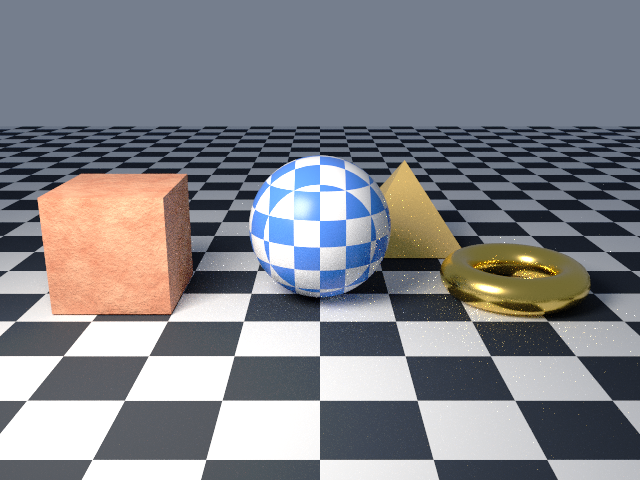

# 7. Import a mesh

Goal: render geometry from a file next to the built-in shapes.

The script is page 6 plus a small OBJ pyramid. Before the `_dsl_` block, lmscript writes `pyramid.obj` with `write_file`, so nothing needs downloading. Inside the block, four lines import it, check it, move it behind the sphere, and give it a material.

Download the full script, or copy it from below:

```sh
curl -O https://raw.githubusercontent.com/lmctl-ai/lmblender/main/docs/tutorial/code/07-import-a-mesh.lms
```

<!-- code: code/07-import-a-mesh.lms -->
```lmscript
obj = """o pyramid
v -1 -1 0
v 1 -1 0
v 1 1 0
v -1 1 0
v 0 0 1.5
f 1 3 2
f 1 4 3
f 1 2 5
f 2 3 5
f 3 4 5
f 4 1 5
""";
write_file("pyramid.obj", obj);
p = _dsl_ cli="lmblender" install="github:lmctl-ai/lmblender@latest";
let ball = scene.uv_sphere(1.0, 48, 24, true);
ball.translate(0.0, 0.0, 1.0);
let box = scene.cube(1.6);
box.translate(-2.8, 0.0, 0.8);
let ring = scene.torus(0.8, 0.25, 48, 16, true);
ring.translate(2.8, 0.0, 0.25);
ball.set_material(scene.checker_material(0.08, 0.25, 0.85, 0.9, 0.92, 0.95, 3.0, 0.3));
let stone = scene.noise_material(0.55, 0.12, 0.05, 0.95, 0.55, 0.35, 3.0, 0.6);
stone.bump(0.4, 0.1, 12.0);
box.set_material(stone);
ring.set_material(scene.material(0.95, 0.7, 0.2, 1.0, 0.25, 0.0, 0.0, 0.0, 0.0, 0.0));
let pyramid = scene.import_obj("pyramid.obj");
scene.expect_int(pyramid.triangle_count(), 6);
pyramid.translate(1.5, 2.6, 0.0);
pyramid.set_material(scene.material(0.85, 0.6, 0.2, 0.0, 0.35, 0.0, 0.0, 0.0, 0.0, 0.0));
scene.checker_ground(20.0, 1.0);
scene.world_color(0.6, 0.7, 0.9, 0.3);
scene.area_light(-3.0, -4.0, 5.0, 0.0, 0.0, 1.0, 1.0, 0.92, 0.82, 600.0, 3.0);
scene.camera_look_at(0.0, -9.0, 3.5, 0.0, 0.0, 0.8, 40.0);
scene.render_png("import-a-mesh.png", 32, 640, 480);
end _dsl_
file = "import-a-mesh.dslb";
savedsl(p, file);
argv = dsl_cli(p);
push(argv, "--dsl");
push(argv, file);
r = system(argv, 3600000);
println(trim(r.stdout));
delete_file(file);
if (r.code != 0) { println(trim(f"lmblender exit {r.code}: {r.stderr}")); exit(1); }
println("wrote import-a-mesh.png");
```

Run it:

```sh
lmscript 07-import-a-mesh.lms
```

Expected output:

```text
wrote import-a-mesh.png
```



The script also leaves `pyramid.obj` in the directory.

- `import_obj`, `import_stl`, `import_ply`, and `import_gltf` (for `.gltf` and `.glb`) each return a mesh you can move, scale, and give a material.
- Coordinates are used as written: Z up, scene units. Rotate or scale Y-up or millimeter models yourself.
- `scene.expect_int(actual, expected)` stops the render with an error if the two numbers differ. Use it to catch a wrong or truncated input file before you spend time rendering.
- OBJ files with an MTL library keep their colors and maps; assigning a material overrides them.

Next: [8. Animation](08-animation.md).
