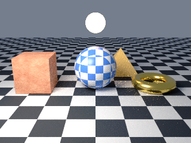
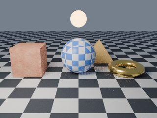

# 7. View transforms

Goal: keep bright light readable by choosing how scene light maps to image pixels.

The scene is one strongly emissive sphere over a floor, with a dim world and the camera from earlier pages. It has no light calls, so lmblender adds its default key light; an emissive material does not count as a light. It is rendered twice from the same script, once per view transform.

```sh
curl -O https://raw.githubusercontent.com/lmctl-ai/lmblender/main/docs/tutorial/code/07-view-transforms.lms
```

<!-- code: code/07-view-transforms.lms -->
```lmscript
p = _dsl_ cli="lmblender" install="github:lmctl-ai/lmblender@latest";
let lamp = scene.uv_sphere(1.0, 48, 24, true);
lamp.translate(0.0, 0.0, 1.0);
lamp.set_material(scene.material(1.0, 0.55, 0.2, 0.0, 0.5, 0.0, 1.0, 0.55, 0.2, 6.0));
scene.ground_plane(0.0, 20.0, 0.5, 0.5, 0.52);
scene.world_color(0.6, 0.7, 0.9, 0.1);
scene.camera_look_at(0.0, -6.0, 2.5, 0.0, 0.0, 0.8, 40.0);
scene.set_view_transform("Standard");
scene.render_png("view-standard.png", 32, 320, 240);
scene.set_view_transform("AgX");
scene.render_png("view-agx.png", 32, 320, 240);
end _dsl_
file = "view-transforms.dslb";
savedsl(p, file);
r = system ${dsl_cli(p)} --dsl ${file};
delete_file(file);
if (r.code != 0) { println(trim(r.stdout)); if (trim(r.stderr) != "") { println(trim(r.stderr)); } exit(1); }
println("wrote view-standard.png, view-agx.png");
```

```sh
lmscript 07-view-transforms.lms
```

Expected output:

```text
wrote view-standard.png, view-agx.png
```

Standard, then AgX:




- The emission strength of 6 is far brighter than white. `Standard` clips the sphere to flat white and shows a saturated orange glow on the floor. `AgX` compresses highlights, so the sphere stays just below white with a pale peach tint and the floor glow is softer and less saturated.
- `set_view_transform` accepts `Standard` (the default), `Filmic`, and `AgX`. It affects PNG output only; EXR files (`render_exr`) keep the raw linear values.
- The two `render_png` calls show that a script can render several images. Every render uses the settings in effect when it is called.

Next: [8. When it fails](08-when-it-fails.md).
