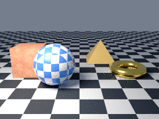
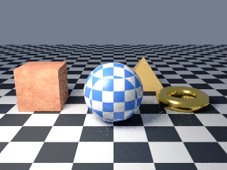
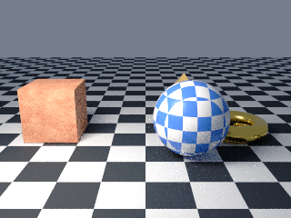

# 8. Animation

Goal: move an object over time and render each frame.

The script is page 7 plus two keyframe lines for the sphere, with `render_png` replaced by `render_sequence` at a smaller size so three frames render quickly.

Download the full script, or copy it from below:

```sh
curl -O https://raw.githubusercontent.com/lmctl-ai/lmblender/main/docs/tutorial/code/08-animation.lms
```

<!-- code: code/08-animation.lms -->
```lmscript
obj = """o pyramid
v -1 -1 0
v 1 -1 0
v 1 1 0
v -1 1 0
v 0 0 1.5
f 1 3 2
f 1 4 3
f 1 2 5
f 2 3 5
f 3 4 5
f 4 1 5
""";
write_file("pyramid.obj", obj);
p = _dsl_ cli="lmblender" install="github:lmctl-ai/lmblender@latest";
let ball = scene.uv_sphere(1.0, 48, 24, true);
ball.translate(0.0, 0.0, 1.0);
let box = scene.cube(1.6);
box.translate(-2.8, 0.0, 0.8);
let ring = scene.torus(0.8, 0.25, 48, 16, true);
ring.translate(2.8, 0.0, 0.25);
ball.set_material(scene.checker_material(0.08, 0.25, 0.85, 0.9, 0.92, 0.95, 3.0, 0.3));
let stone = scene.noise_material(0.55, 0.12, 0.05, 0.95, 0.55, 0.35, 3.0, 0.6);
stone.bump(0.4, 0.1, 12.0);
box.set_material(stone);
ring.set_material(scene.material(0.95, 0.7, 0.2, 1.0, 0.25, 0.0, 0.0, 0.0, 0.0, 0.0));
ball.keyframe_transform(0, -1.2, -1.5, 1.0, "ease");
ball.keyframe_transform(2, 1.2, -1.5, 1.0, "ease");
let pyramid = scene.import_obj("pyramid.obj");
scene.expect_int(pyramid.triangle_count(), 6);
pyramid.translate(1.5, 2.6, 0.0);
pyramid.set_material(scene.material(0.85, 0.6, 0.2, 0.0, 0.35, 0.0, 0.0, 0.0, 0.0, 0.0));
scene.checker_ground(20.0, 1.0);
scene.world_color(0.6, 0.7, 0.9, 0.3);
scene.area_light(-3.0, -4.0, 5.0, 0.0, 0.0, 1.0, 1.0, 0.92, 0.82, 600.0, 3.0);
scene.camera_look_at(0.0, -9.0, 3.5, 0.0, 0.0, 0.8, 40.0);
scene.render_sequence("animation-{frame}.png", 0, 2, 16, 320, 240);
end _dsl_
file = "animation.dslb";
savedsl(p, file);
r = system ${dsl_cli(p)} --dsl ${file};
delete_file(file);
if (r.code != 0) { println(trim(r.stdout)); if (trim(r.stderr) != "") { println(trim(r.stderr)); } exit(1); }
println("wrote animation-0.png, animation-1.png, animation-2.png");
```

Run it:

```sh
lmscript 08-animation.lms
```

Expected output:

```text
wrote animation-0.png, animation-1.png, animation-2.png
```







- `keyframe_transform(frame, x, y, z, interpolation)` sets the object's position at a frame. Positions are absolute, not offsets: here the sphere moves from x = -1.2 to x = 1.2, a little in front of where it stood. `"ease"` starts and ends slowly; `"linear"` moves at constant speed.
- `render_sequence(pattern, first, last, samples, width, height)` renders every frame from first to last inclusive. `{frame}` in the path becomes the frame number.
- `render_apng(path, first, last, samples, width, height, fps)` writes one animated PNG instead.
- Cameras, visibility, material color, emission, and point light strength can also be keyed. See [ANIMATION.md](../ANIMATION.md).

Next: [9. View transforms](09-view-transforms.md).
