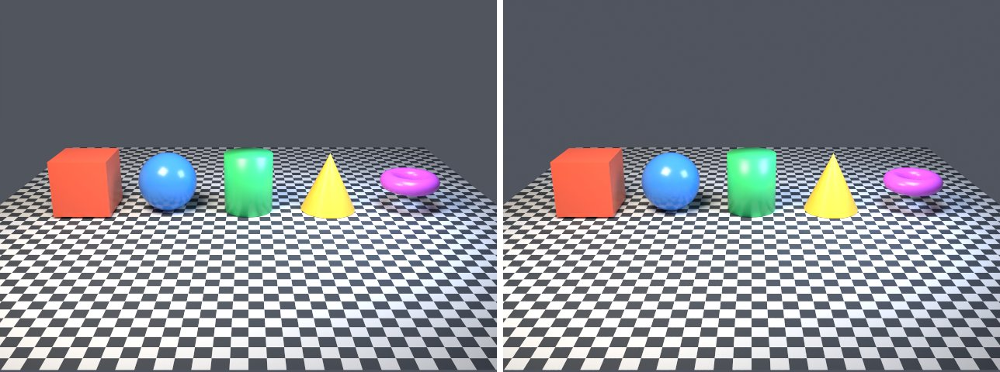

# 9. Compared with Blender

Goal: show, with measured numbers, how close lmblender's renders are to Blender's for the same scenes, and where they differ.

Every top-level example in [examples/](../../examples/) was rendered twice: once by lmblender, and once by Blender 5.2.2 (Cycles, CPU) from a Python script that builds the same scene with `bpy`. Each example has its own page with both images side by side, the Python port, the timings, and the differences found.



Left: lmblender. Right: Blender. Mean difference 2.8 of 255; this is one of the closest pairs. The median pair differs by 5.45 of 255, and the table below lists every example, including the worst (19.4).

## How the comparison was made

- The Blender side uses [lmb_bpy.py](blender/py/lmb_bpy.py), a bpy module with one method per lmblender call. It follows the host's C++ code: the same vertex lists for primitives, strands, lofts, and outlines; the same light orientation, units, and camera matrix; the same Principled BSDF settings; textures in object coordinates; the same keyframe interpolation; and Cycles settings matched to the host (Standard view, box filter, bounces, seed, light clamps, adaptive sampling).
- Each port in [blender/py/](blender/py/) was generated from the example's `_dsl_` block by [lms2py.py](blender/lms2py.py), then checked by hand. Most ports read line for line like the `.lms` file.
- "Mean difference" is the mean absolute RGB difference between the two PNGs, in 0 to 255 steps. "Silhouette overlap" is the intersection over union of the pixels that differ from the corner background color; it is only meaningful when the background is uniform.
- Host: Linux arm64, four-core Neoverse-N1 (AWS Graviton2), four render threads on both sides. lmblender ran from the v0.3.4 release, except where noted.
- Timings are single wall-clock runs of the whole program, including about 0.8 s of Blender startup and lmscript compile time. Other jobs shared the machine during part of the run and the same example varied up to two times between runs, so compare the two numbers within a row, not across rows.

## Summary

- 44 examples ported; all 44 ran on both sides.
- 39 examples produce PNG images. Up to three images per example were compared (first, middle, and last frame for sequences), 49 pairs in all. The median mean difference is 5.45 of 255 (best 0.6, worst 19.4). The table shows the first pair of each example; the example pages show all of them.
- Timing with the v0.3.4 release (23 examples that do not denoise): lmblender 88.4 s in total, Blender 87.6 s. Small scenes take about one second on both sides; lmblender was faster on `embree-heavy` (3.7 s against 10.5 s).
- Timing with a local 0.3.3 build (21 examples that denoise, which crash with the release on this CPU): lmblender 498.4 s, Blender 360.9 s. lmblender was much slower on `motion-blur` (108.6 s against 16.9 s) and `volume-fog` (67.6 s against 46.4 s). These numbers describe that build, not the release.

| Example | lmblender s | Blender s | Mean difference /255 | Silhouette overlap |
|---|---|---|---|---|
| [animation-tween](blender/animation-tween.md) | 11.5 | 10.4 | 5.4 | 0.93 |
| [animation-visibility-optics](blender/animation-visibility-optics.md) | 2.6 (local build) | 3.5 | 7.1 | 0.85 |
| [backface-culling](blender/backface-culling.md) | 1.6 | 1.8 | 2.0 | 1.00 |
| [camera-dof](blender/camera-dof.md) | 24.6 (local build) | 20.9 | 5.2 | 0.96 |
| [camera-look-at](blender/camera-look-at.md) | 1.9 | 1.9 | 4.6 | 1.00 |
| [denoise-quality](blender/denoise-quality.md) | 2.8 (local build) | 3.5 | 7.5 | 0.94 |
| [display-transforms](blender/display-transforms.md) | 1.6 | 1.9 | 0.7 | not meaningful (flat panel) |
| [embree-heavy](blender/embree-heavy.md) | 3.7 | 10.5 | 5.0 | 0.96 |
| [environment-texture](blender/environment-texture.md) | 20.1 (local build) | 26.9 | 19.3 | 1.00 |
| [glass-opaque-control](blender/glass-opaque-control.md) | 19.9 (local build) | 17.0 | 1.6 | 0.98 |
| [glass-transmission](blender/glass-transmission.md) | 29.1 (local build) | 23.5 | 2.1 | 0.98 |
| [glb-import](blender/glb-import.md) | 1.7 | 2.0 | 19.4 | 1.00 |
| [gltf-emission](blender/gltf-emission.md) | 1.8 | 2.0 | 6.1 | 1.00 |
| [gltf-import](blender/gltf-import.md) | 1.7 | 2.0 | 19.4 | 1.00 |
| [image-texture](blender/image-texture.md) | 15.6 | 13.8 | 7.6 | 0.99 |
| [import-mesh](blender/import-mesh.md) | 0.9 | 0.9 | no image | no image |
| [import-ply](blender/import-ply.md) | 1.0 | 1.3 | 4.6 | 1.00 |
| [light-falloff](blender/light-falloff.md) | 10.7 (local build) | 9.6 | 4.5 | 0.70 |
| [loft-outline](blender/loft-outline.md) | 20.9 (local build) | 26.5 | 3.8 | 1.00 |
| [material-maps](blender/material-maps.md) | 35.4 (local build) | 25.1 | 4.7 | 0.98 |
| [material-nodes-control](blender/material-nodes-control.md) | 10.0 (local build) | 9.2 | 9.9 | 0.99 |
| [material-nodes](blender/material-nodes.md) | 11.4 (local build) | 10.9 | 9.6 | 0.99 |
| [material-principled](blender/material-principled.md) | 0.9 | 1.2 | 10.4 | 1.00 |
| [mesh-instances](blender/mesh-instances.md) | 0.9 | 1.2 | 4.9 | 0.98 |
| [motion-blur](blender/motion-blur.md) | 108.6 (local build) | 16.9 | 6.1 | 0.96 |
| [obj-mtl-gallery](blender/obj-mtl-gallery.md) | 6.6 | 5.5 | 5.8 | 0.99 |
| [orthographic-camera](blender/orthographic-camera.md) | 13.6 | 12.4 | 1.8 | 1.00 |
| [primitives-gallery](blender/primitives-gallery.md) | 13.9 (local build) | 12.1 | 2.8 | 0.96 |
| [procedural-materials](blender/procedural-materials.md) | 10.8 | 9.3 | 11.0 | 1.00 |
| [render-exr](blender/render-exr.md) | 0.9 | 1.0 | no image | no image |
| [render-mesh-xml-oracle](blender/render-mesh-xml-oracle.md) | 1.0 | 1.2 | 4.9 | 0.99 |
| [render-mesh](blender/render-mesh.md) | 0.9 | 1.2 | 4.9 | 0.99 |
| [render-passes](blender/render-passes.md) | 0.9 | 1.1 | no image | no image |
| [render-settings](blender/render-settings.md) | 0.8 | 1.2 | 4.9 | 0.99 |
| [render-timeout](blender/render-timeout.md) | 7.3 | 2.6 | no image | no image |
| [sky-texture](blender/sky-texture.md) | 10.6 (local build) | 12.9 | 14.2 | 0.98 |
| [spot-falloff](blender/spot-falloff.md) | 9.6 (local build) | 8.6 | 9.7 | 0.85 |
| [strands-showcase](blender/strands-showcase.md) | 40.9 (local build) | 35.2 | 9.7 | 0.95 |
| [subsurface-control](blender/subsurface-control.md) | 16.6 (local build) | 14.1 | 8.3 | 1.00 |
| [subsurface](blender/subsurface.md) | 23.4 (local build) | 18.7 | 8.3 | 1.00 |
| [transparent-film](blender/transparent-film.md) | 7.6 (local build) | 8.3 | 4.7 | 0.92 |
| [version](blender/version.md) | 0.7 | 0.9 | no image | no image |
| [volume-control](blender/volume-control.md) | 12.2 (local build) | 10.8 | 2.8 | 0.99 |
| [volume-fog](blender/volume-fog.md) | 67.6 (local build) | 46.4 | 1.7 | 1.00 |

"(local build)" marks examples whose lmblender side was rendered with a locally built 0.3.3 executable, because the v0.3.4 linux-arm64 release crashes in its denoiser on this CPU (see below).

## Differences that come from lmblender

These are lmblender issues the comparison exposed. They are reported here as found; none is fixed in v0.3.4.

1. Denoiser crash on some arm64 CPUs. The v0.3.3 and v0.3.4 linux-arm64 releases stop with `Illegal instruction` in OpenImageDenoise (an SVE instruction in `autoexposureDownsample`) when denoising is on and the CPU has no SVE, such as AWS Graviton2. 21 of the 44 examples denoise. A locally built executable on the same machine works.
2. Dark tones render too dark. lmblender's Standard view transform uses a 33-point lookup table spaced on a log scale whose first step is 0.093 linear, and interpolating linearly across that step undershoots the sRGB curve. A background of linear 0.04 becomes 38 of 255 in lmblender and 56 in Blender (the correct sRGB value). This is the main source of difference on dark backgrounds.
3. PNG and JPEG color textures are not decoded from sRGB. lmblender runs Cycles with color management disabled, so 8-bit image textures (glTF base color, environment PNGs) are used as linear values and render lighter and less saturated. In a separate experiment that is not part of the published ports, telling Blender to read the environment PNG as non-color data reduced that example's difference from 19.3 to 6.9.
4. The fallback camera is squeezed. When a scene sets no camera, lmblender's default view is about 1.5 times narrower horizontally at 4:3. The ports reproduce the squeeze on purpose so the images line up; with an explicit camera, `studio_setup`, or `fit_camera` both renderers agree. The tutorial pages always set a camera for this reason.
5. Failures print nothing useful from the examples. The host writes its error JSON to standard output, but the `examples/` scripts print only standard error, so a failure shows as `lmblender exit 3:` with no message. `material-maps` and `obj-mtl-gallery` also need fixtures that only `test.sh` generates.

## Differences that come from the Blender side

1. Blender has no APNG writer, so `render_apng` becomes a PNG sequence.
2. `render_passes` becomes one multilayer EXR plus a combined PNG, not lmblender's four EXR and PNG pairs; the pass images were not compared.
3. EXR outputs were not compared numerically.
4. `render_timeout` has no true equivalent: Blender's time limit stops sampling and saves an image, while lmblender cancels and reports `RENDER_TIMEOUT`.
5. Blender's glTF importer splits vertices differently, so the vertex-count checks in the glTF examples report 8 where lmblender reports 4. Blender's OBJ importer converts MTL materials itself, so `obj-mtl-gallery` materials are close but not identical.

## Not compared

The examples in `examples/presets/`, `examples/video/`, `examples/compose/` (needs lmcad), `examples/bridge/` (needs a BlenderCLI checkout), and `examples/dsl/` were not ported. Presets and the video scenes use calls (`use_preset`, `label`, `glow_orb`, `arrow_between`, `ring_arc`) that the bpy module does not implement yet.

## Reproduce

From the repository root, with lmscript and a Blender 5.x executable on your PATH:

```sh
mkdir -p build
lmscript examples/primitives-gallery.lms
blender -b --factory-startup --python docs/tutorial/blender/py/primitives-gallery.py
```

lmblender writes `build/primitives-gallery.png` and Blender writes `blender/primitives-gallery.png`. Each example page lists its own commands and any fixture it needs.

Next: write your own scene, starting from page 3 or 4, and look up every call in [LLM_GUIDE.md](../LLM_GUIDE.md). Back to the [tutorial index](index.md).
