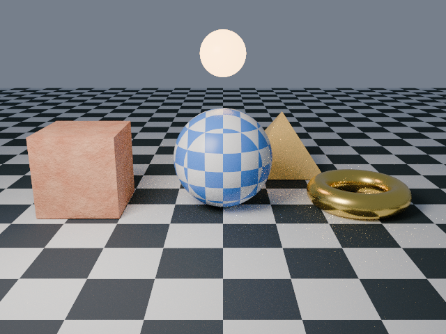

# 10. When it fails

Goal: read an lmblender error and fix the script.

The script is page 9 rendered once with AgX at full size, with one deliberate mistake on line 20: the torus has its two radii swapped, so the tube is thicker than the ring. It writes `pyramid.obj` before the scene block runs, so that file appears even though the render fails.

Download the full script, or copy it from below:

```sh
curl -O https://raw.githubusercontent.com/lmctl-ai/lmblender/main/docs/tutorial/code/10-when-it-fails.lms
```

<!-- code: code/10-when-it-fails.lms -->
```lmscript
obj = """o pyramid
v -1 -1 0
v 1 -1 0
v 1 1 0
v -1 1 0
v 0 0 1.5
f 1 3 2
f 1 4 3
f 1 2 5
f 2 3 5
f 3 4 5
f 4 1 5
""";
write_file("pyramid.obj", obj);
p = _lmcode_ cli="lmblender" install="github:lmctl-ai/lmblender@latest";
let ball = scene.uv_sphere(1.0, 48, 24, true);
ball.translate(0.0, 0.0, 1.0);
let box = scene.cube(1.6);
box.translate(-2.8, 0.0, 0.8);
let ring = scene.torus(0.25, 0.8, 48, 16, true);
ring.translate(2.8, 0.0, 0.25);
ball.set_material(scene.checker_material(0.08, 0.25, 0.85, 0.9, 0.92, 0.95, 3.0, 0.3));
let stone = scene.noise_material(0.55, 0.12, 0.05, 0.95, 0.55, 0.35, 3.0, 0.6);
stone.bump(0.4, 0.1, 12.0);
box.set_material(stone);
ring.set_material(scene.material(0.95, 0.7, 0.2, 1.0, 0.25, 0.0, 0.0, 0.0, 0.0, 0.0));
ball.keyframe_transform(0, -1.2, -1.5, 1.0, "ease");
ball.keyframe_transform(2, 1.2, -1.5, 1.0, "ease");
let pyramid = scene.import_obj("pyramid.obj");
scene.expect_int(pyramid.triangle_count(), 6);
pyramid.translate(1.5, 2.6, 0.0);
pyramid.set_material(scene.material(0.85, 0.6, 0.2, 0.0, 0.35, 0.0, 0.0, 0.0, 0.0, 0.0));
let lamp = scene.glow_orb(0.0, 1.2, 3.0, 0.5, 1.0, 0.55, 0.2, 8.0);
scene.checker_ground(20.0, 1.0);
scene.world_color(0.6, 0.7, 0.9, 0.3);
scene.area_light(-3.0, -4.0, 5.0, 0.0, 0.0, 1.0, 1.0, 0.92, 0.82, 600.0, 3.0);
scene.camera_look_at(0.0, -9.0, 3.5, 0.0, 0.0, 0.8, 40.0);
scene.set_view_transform("AgX");
scene.render_png("when-it-fails.png", 32, 640, 480);
end _lmcode_
file = "when-it-fails.dslb";
savedsl(p, file);
argv = dsl_cli(p);
push(argv, "--lmcode");
push(argv, file);
r = system(argv, 3600000);
println(trim(r.stdout));
delete_file(file);
if (r.code != 0) { if (trim(r.stderr) != "") { println(trim(r.stderr)); } exit(1); }
println("wrote when-it-fails.png");
```

Run it:

```sh
lmscript 10-when-it-fails.lms
```

Expected output (the script exits with status 1 and writes no image):

```text
{"ok": false, "phase": "run", "code": "RUN_HOST", "message": "dsl line 20:18: torus radii require major > minor > 0", "line": 20, "column": 18}
```

The host reports every failure as one JSON line on standard output:

- `code` names the kind of problem.
- `message` names the call and its accepted range.
- `line` and `column` point into the script file. Line 20 is the `scene.torus` call.

Fix: swap the two radii back to `scene.torus(0.8, 0.25, 48, 16, true)` and run the script again. It then prints:

```text
wrote when-it-fails.png
```



Every script on these pages prints `r.stdout` on failure because the JSON error is on standard output; standard error is usually empty.

## Common failures

| What you see | Cause | Fix |
|---|---|---|
| `RUN_HOST` with a range in the message | A value is outside its allowed range | Use a value inside the range in the message |
| `_dsl_: install github:lmctl-ai/lmblender@latest: GitHub API HTTP 403 rate limit exceeded` | lmscript asks GitHub for the latest release on each run, and unauthenticated requests are limited per hour | Wait an hour, or set a token for the run: `GITHUB_TOKEN=$(gh auth token) lmscript FILE.lms` |
| `r.code` is null and nothing is printed after about 60 seconds | lmscript's shell-style `system` call stops a program after 60 s by default, and a large render took longer | Lower the samples or size, or run the host with a longer limit: `argv = dsl_cli(p); push(argv, "--lmcode"); push(argv, file); r = system(argv, 3600000);` as the repository examples do |
| `LOAD_SCHEMA_MISMATCH` or `LOAD_BAD_BYTECODE`, exit 3 | The bytecode was compiled for a different lmblender version | Run the `.lms` again so lmscript recompiles it; do not reuse old `.dslb` files |
| `OUTPUT_PATH` | The output directory does not exist, or is a symlink | Create the directory first, for example `mkdir("renders");` in lmscript before the block |
| `OBJ_INVALID`, `GLTF_INVALID`, `IMAGE_INVALID` | The input file is broken, or a path is wrong | Check that the path is relative to where you run lmscript, and open the file in another tool |
| `RENDER_TIMEOUT` | One render ran longer than `render_timeout(seconds)` | Lower the samples or resolution, or raise the timeout |
| `GEOMETRY_BUDGET` | More than 10 million vertices or 20 million triangles | Use `instance_mesh` for copies, or fewer segments |
| `Illegal instruction` (exit 132), or `r.code` is null, on Linux arm64 when denoising is on | The v0.3.3 and v0.3.4 linux-arm64 releases were built with SVE instructions in the OIDN denoiser, which CPUs such as AWS Graviton2 (Neoverse-N1) do not have | Leave denoising off (the default) or build lmblender from source ([BUILD.md](../../BUILD.md)). The build is fixed in the source for the next release; renders without the denoiser are not affected |

RUN_HOST, OUTPUT_PATH, the GitHub rate limit, and the denoiser crash were reproduced while writing these pages; the other rows come from the error list in [LLM_GUIDE.md](../LLM_GUIDE.md#errors-and-recovery).

Next: [11. Compared with Blender](11-compare-with-blender.md).
