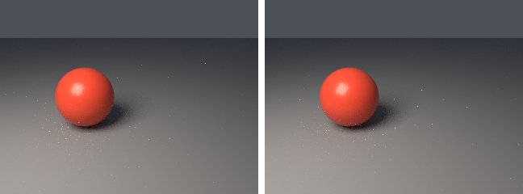
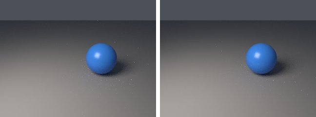

# animation-tween in lmblender and Blender

Goal: render [examples/animation-tween.lms](../../../examples/animation-tween.lms) with lmblender and the same scene with Blender 5.2 from Python, and compare the results.

Left: lmblender. Right: Blender.



`tween-0.png`: mean absolute difference 1.1 of 255, silhouette overlap 0.98.



`tween-4.png`: mean absolute difference 0.9 of 255, silhouette overlap 0.98.


`tween-8.png`: mean absolute difference 1.1 of 255, silhouette overlap 0.98.

## Timing

| Renderer | Seconds, whole run | Binary |
|---|---|---|
| lmblender | 21.3 | built from source with the fixes on page 11 (v0.3.4 plus the color, camera, and denoiser fixes) |
| Blender 5.2.2 | 21.7 | source build, Cycles CPU, about 0.8 s of it is Blender startup |

Both runs used four threads on a four-core Neoverse-N1 (AWS Graviton2) Linux arm64 host.

## Differences and gaps

- Blender has no APNG writer, so the port renders the frames of the `render_apng` call as PNG files. Both sides render every frame as a separate still from sampled key values.

## Run both

From the repository root, with lmscript and Blender 5.x on your PATH:

```sh
mkdir -p build
lmscript examples/animation-tween.lms
blender -b --factory-startup --python docs/tutorial/blender/py/animation-tween.py
```

Expected lmblender output (the host's JSON result):

```text
{"ok": true, "result": null}
```

Expected Blender output, among Blender's own log lines (seconds vary from run to run):

```text
blender render blender/tween-0.png: 0.94s
blender render blender/tween-1.png: 1.21s
blender render blender/tween-2.png: 1.34s
blender render blender/tween-3.png: 1.33s
blender render blender/tween-4.png: 1.38s
blender render blender/tween-5.png: 1.37s
blender render blender/tween-6.png: 1.58s
blender render blender/tween-7.png: 1.53s
blender render blender/tween-8.png: 1.43s
blender render blender/animation-tween-0000.png: 0.82s
blender render blender/animation-tween-0001.png: 0.81s
blender render blender/animation-tween-0002.png: 0.86s
blender render blender/animation-tween-0003.png: 0.76s
blender render blender/animation-tween-0004.png: 1.02s
blender render blender/animation-tween-0005.png: 0.91s
blender render blender/animation-tween-0006.png: 0.91s
blender render blender/animation-tween-0007.png: 0.79s
blender render blender/animation-tween-0008.png: 0.77s
blender total 20.04s
```

lmblender writes into `build/`, including the compiled `.dslb`; the Blender port writes the same file names into `blender/`. Ubuntu's packaged Blender 4.0 also runs the ports, but without denoising (it has no OpenImageDenoise) and its glTF importer needs `python3-numpy`.

## Blender port

The port calls [lmb_bpy.py](py/lmb_bpy.py), which implements each lmblender call with bpy and the host's semantics.

<!-- code: blender/py/animation-tween.py -->
```python
# SPDX-FileCopyrightText: 2025-2026 lmblender contributors
# SPDX-License-Identifier: MIT
# Blender/bpy port of examples/animation-tween.lms (generated by docs/tutorial/blender/lms2py.py, reviewed by hand)
import os, sys
sys.path.insert(0, os.path.dirname(os.path.abspath(__file__)))
import lmb_bpy

scene = lmb_bpy.Scene()
sphere = scene.uv_sphere(1.0, 32, 16, True)
red = scene.material(0.78, 0.08, 0.035, 0.05, 0.28, 0.0, 0.0, 0.0, 0.0, 0.0)
sphere.set_material(red)
sphere.keyframe_transform(0, -1.5, 0.0, 0.0, "ease")
sphere.keyframe_transform(4, 1.5, 0.0, 0.0, "ease")
sphere.keyframe_transform(8, -1.5, 0.0, 0.0, "ease")
red.keyframe_color(0, 0.9, 0.08, 0.04, "linear")
red.keyframe_color(4, 0.04, 0.25, 0.95, "linear")
red.keyframe_color(8, 0.9, 0.08, 0.04, "linear")
scene.ground_plane(-1.05, 20.0, 0.27, 0.29, 0.32)
scene.area_light(-4.0, -5.0, 6.0, 0.0, 0.0, 0.0, 1.0, 0.86, 0.72, 900.0, 5.0)
scene.camera_look_at(0.0, -8.0, 3.2, 0.0, 0.0, 0.0, 42.0)
scene.camera_keyframe(0, 0.0, -8.0, 3.2, 0.0, 0.0, 0.0, "ease")
scene.camera_keyframe(4, 0.0, -9.0, 4.0, 0.0, 0.0, 0.0, "ease")
scene.camera_keyframe(8, 0.0, -8.0, 3.2, 0.0, 0.0, 0.0, "ease")
scene.render_sequence("blender/tween-{frame}.png", 0, 8, 16, 320, 240)
scene.render_apng("blender/animation-tween.apng", 0, 8, 8, 320, 240, 12)
lmb_bpy.done()
```

Back to [the comparison overview](../11-compare-with-blender.md).
