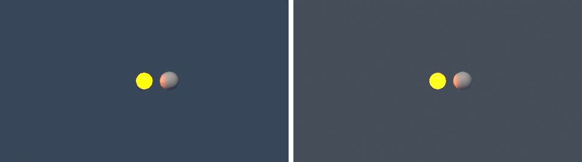
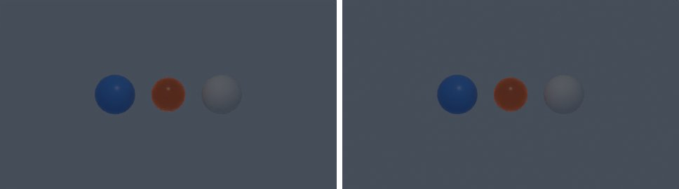

# animation-visibility-optics in lmblender and Blender

Goal: render [examples/animation-visibility-optics.lms](../../../examples/animation-visibility-optics.lms) with lmblender and the same scene with Blender 5.2 from Python, and compare the results.

Left: lmblender. Right: Blender.


`animation-visibility-0.png`: mean absolute difference 7.1 of 255, silhouette overlap 0.85.



`animation-visibility-1.png`: mean absolute difference 6.9 of 255, silhouette overlap 0.95.



`animation-visibility-2.png`: mean absolute difference 7.1 of 255, silhouette overlap 0.85.

## Timing

| Renderer | Seconds, whole run | Binary |
|---|---|---|
| lmblender | 2.6 | local 0.3.3 build (the v0.3.4 linux-arm64 release crashes with SIGILL when denoising on this CPU) |
| Blender 5.2.2 | 3.5 | source build, Cycles CPU, about 0.8 s of it is Blender startup |

Both runs used four threads on a four-core Neoverse-N1 (AWS Graviton2) Linux arm64 host.

## Differences and gaps

- The port samples visibility, camera, optics, emission, and point light keys per frame with the same interpolation code as the host.
- lmblender's Standard view transform renders dark tones darker than Blender (for example 38 instead of 56 out of 255 for a linear value of 0.04), which accounts for most of the difference on dark backgrounds.

## Run both

From the repository root (the Blender command needs Blender 5.x on your PATH):

```sh
mkdir -p build
lmscript examples/animation-visibility-optics.lms
blender -b --factory-startup --python docs/tutorial/blender/py/animation-visibility-optics.py
```

lmblender writes into `build/`; the Blender port writes the same file names into `blender/`. The lmblender example prints nothing when it succeeds, so check that the image exists; it also leaves its compiled `.dslb` file in `build/`.

## Blender port

The port calls [lmb_bpy.py](py/lmb_bpy.py), which implements each lmblender call with bpy and the host's semantics.

<!-- code: blender/py/animation-visibility-optics.py -->
```python
# SPDX-FileCopyrightText: 2025-2026 lmblender contributors
# SPDX-License-Identifier: MIT
# Blender/bpy port of examples/animation-visibility-optics.lms (generated by docs/tutorial/blender/lms2py.py, reviewed by hand)
import os, sys
sys.path.insert(0, os.path.dirname(os.path.abspath(__file__)))
import lmb_bpy

scene = lmb_bpy.Scene()
hidden = scene.uv_sphere(0.75, 24, 12, True)
matte = scene.material(0.08, 0.32, 0.92, 0.0, 0.35, 0.0, 0.0, 0.0, 0.0, 0.0)
hidden.set_material(matte)
hidden.translate(-2.0, 0.0, 0.0)
hidden.keyframe_visible(0, True, "linear")
hidden.keyframe_visible(1, False, "linear")
hidden.keyframe_visible(2, True, "linear")
lamp = scene.uv_sphere(0.65, 24, 12, True)
glow = scene.material(0.08, 0.08, 0.08, 0.0, 0.3, 1.0, 0.12, 0.02, 0.0, 1.0)
lamp.set_material(glow)
lamp.translate(0.0, 0.0, 0.0)
glow.keyframe_emission_strength(0, 0.5, "linear")
glow.keyframe_emission_strength(1, 50.0, "linear")
glow.keyframe_emission_strength(2, 0.5, "linear")
still = scene.uv_sphere(0.75, 24, 12, True)
white = scene.material(0.8, 0.8, 0.8, 0.0, 0.6, 0.0, 0.0, 0.0, 0.0, 0.0)
still.set_material(white)
still.translate(2.0, 0.0, 0.0)
scene.point_light(0.0, -4.0, 5.0, 1.0, 0.9, 0.8, 80.0)
scene.point_light_keyframe(0, 0, 80.0, "linear")
scene.point_light_keyframe(0, 1, 600.0, "linear")
scene.point_light_keyframe(0, 2, 80.0, "linear")
scene.camera_look_at(0.0, -9.0, 2.4, 0.0, 0.0, 0.0, 42.0)
scene.camera_optics_keyframe(0, 42.0, 8.0, "linear")
scene.camera_optics_keyframe(1, 70.0, 8.0, "linear")
scene.camera_optics_keyframe(2, 42.0, 8.0, "linear")
scene.world_color(0.12, 0.15, 0.2, 0.5)
scene.render_settings(8, 0, True)
scene.set_threads(2)
scene.render_sequence("blender/animation-visibility-{frame}.png", 0, 2, 8, 480, 270)
lmb_bpy.done()
```

Back to [the comparison overview](../09-compare-with-blender.md).
