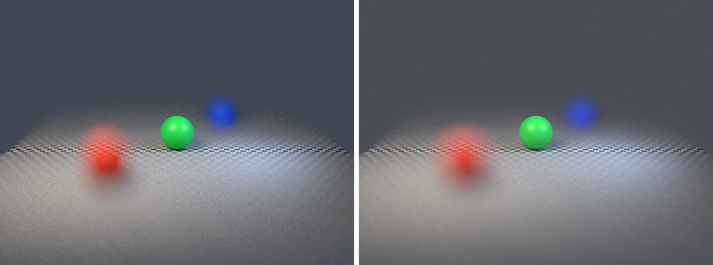

# camera-dof in lmblender and Blender

Goal: render [examples/camera-dof.lms](../../../examples/camera-dof.lms) with lmblender and the same scene with Blender 5.2 from Python, and compare the results.

Left: lmblender. Right: Blender.



`camera-dof.png`: mean absolute difference 5.2 of 255, silhouette overlap 0.96.

## Timing

| Renderer | Seconds, whole run | Binary |
|---|---|---|
| lmblender | 24.6 | local 0.3.3 build (the v0.3.4 linux-arm64 release crashes with SIGILL when denoising on this CPU) |
| Blender 5.2.2 | 20.9 | source build, Cycles CPU, about 0.8 s of it is Blender startup |

Both runs used four threads on a four-core Neoverse-N1 (AWS Graviton2) Linux arm64 host.

## Differences and gaps

- lmblender's Standard view transform renders dark tones darker than Blender (for example 38 instead of 56 out of 255 for a linear value of 0.04), which accounts for most of the difference on dark backgrounds.

## Run both

From the repository root (the Blender command needs Blender 5.x on your PATH):

```sh
mkdir -p build
lmscript examples/camera-dof.lms
blender -b --factory-startup --python docs/tutorial/blender/py/camera-dof.py
```

lmblender writes into `build/`; the Blender port writes the same file names into `blender/`.

## Blender port

The port calls [lmb_bpy.py](py/lmb_bpy.py), which implements each lmblender call with bpy and the host's semantics.

<!-- code: blender/py/camera-dof.py -->
```python
# SPDX-FileCopyrightText: 2025-2026 lmblender contributors
# SPDX-License-Identifier: MIT
# Blender/bpy port of examples/camera-dof.lms (generated by docs/tutorial/blender/lms2py.py, reviewed by hand)
import os, sys
sys.path.insert(0, os.path.dirname(os.path.abspath(__file__)))
import lmb_bpy

scene = lmb_bpy.Scene()
near = scene.uv_sphere(0.8,48,32,True)
near.translate(-2.6,-4.0,0.8)
red = scene.material(0.9,0.06,0.03,0.0,0.45,0.0,0.0,0.0,0.0,0.0)
near.set_material(red)
focus = scene.uv_sphere(0.8,48,32,True)
focus.translate(0.0,0.0,0.8)
green = scene.material(0.03,0.8,0.1,0.0,0.4,0.0,0.0,0.0,0.0,0.0)
focus.set_material(green)
far = scene.uv_sphere(0.8,48,32,True)
far.translate(2.6,4.0,0.8)
blue = scene.material(0.03,0.1,0.9,0.0,0.45,0.0,0.0,0.0,0.0,0.0)
far.set_material(blue)
scene.checker_ground(8.0,4.0)
scene.world_color(0.15,0.17,0.2,0.45)
scene.area_light(-4.0,-5.0,7.0,0.0,0.0,0.0,1.0,0.85,0.7,700.0,4.0)
scene.area_light(4.0,-2.0,4.0,0.0,0.0,0.0,0.55,0.7,1.0,250.0,3.0)
scene.camera_look_at(0.0,-16.0,5.0,0.0,0.0,0.8,42.0)
scene.camera_dof(3.0,16.5)
scene.render_settings(12,314159,True)
scene.render_png("blender/camera-dof.png",96,640,480)
lmb_bpy.done()
```

Back to [the comparison overview](../09-compare-with-blender.md).
