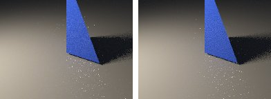
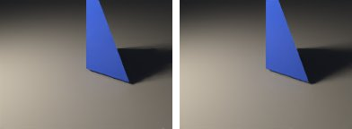
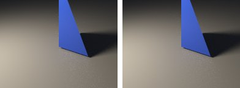

# denoise-quality in lmblender and Blender

Goal: render [examples/denoise-quality.lms](../../../examples/denoise-quality.lms) with lmblender and the same scene with Blender 5.2 from Python, and compare the results.

Left: lmblender. Right: Blender.



`denoise-noisy.png`: mean absolute difference 3.0 of 255, silhouette overlap 0.97.



`denoise-filtered.png`: mean absolute difference 0.6 of 255, silhouette overlap 0.98.



`denoise-reference.png`: mean absolute difference 0.9 of 255, silhouette overlap 0.97.

## Timing

| Renderer | Seconds, whole run | Binary |
|---|---|---|
| lmblender | 2.0 | built from source with the fixes on page 11 (v0.3.4 plus the color, camera, and denoiser fixes) |
| Blender 5.2.2 | 2.5 | source build, Cycles CPU, about 0.8 s of it is Blender startup |

Both runs used four threads on a four-core Neoverse-N1 (AWS Graviton2) Linux arm64 host.

## Differences and gaps

- Blender runs the same OIDN denoiser. The v0.3.3 and v0.3.4 linux-arm64 releases crash in this denoiser on CPUs without SVE; the fixed build does not.

## Run both

From the repository root, with lmscript and Blender 5.x on your PATH:

```sh
mkdir -p build
lmscript examples/denoise-quality.lms
blender -b --factory-startup --python docs/tutorial/blender/py/denoise-quality.py
```

Expected lmblender output (the host's JSON result):

```text
{"ok": true, "result": null}
```

Expected Blender output, among Blender's own log lines (seconds vary from run to run):

```text
blender render blender/denoise-noisy.png: 0.21s
blender render blender/denoise-filtered.png: 0.19s
blender render blender/denoise-reference.png: 1.15s
blender total 1.63s
```

lmblender writes into `build/`, including the compiled `.dslb`; the Blender port writes the same file names into `blender/`. Ubuntu's packaged Blender 4.0 also runs the ports, but without denoising (it has no OpenImageDenoise) and its glTF importer needs `python3-numpy`.

## Blender port

The port calls [lmb_bpy.py](py/lmb_bpy.py), which implements each lmblender call with bpy and the host's semantics.

<!-- code: blender/py/denoise-quality.py -->
```python
# SPDX-FileCopyrightText: 2025-2026 lmblender contributors
# SPDX-License-Identifier: MIT
# Blender/bpy port of examples/denoise-quality.lms (generated by docs/tutorial/blender/lms2py.py, reviewed by hand)
import os, sys
sys.path.insert(0, os.path.dirname(os.path.abspath(__file__)))
import lmb_bpy

scene = lmb_bpy.Scene()
mesh = scene.import_obj("tests/fixtures/tetra.obj")
blue = scene.material(0.04, 0.12, 0.8, 0.0, 0.28, 0.0, 0.0, 0.0, 0.0, 0.0)
mesh.set_material(blue)
scene.ground_plane(-0.12, 40.0, 0.32, 0.32, 0.32)
scene.world_color(0.12, 0.14, 0.18, 0.18)
scene.area_light(-4.0, -5.0, 6.0, 0.0, 0.0, 0.2, 1.0, 0.88, 0.7, 950.0, 2.5)
scene.camera_look_at(4.0, -6.0, 4.0, 0.0, 0.0, 0.2, 38.0)
scene.render_settings(8, 314159, False)
scene.render_png("blender/denoise-noisy.png", 4, 192, 144)
scene.render_settings(8, 314159, True)
scene.render_png("blender/denoise-filtered.png", 4, 192, 144)
scene.render_settings(8, 314159, False)
scene.render_png("blender/denoise-reference.png", 64, 192, 144)
lmb_bpy.done()
```

Back to [the comparison overview](../11-compare-with-blender.md).
