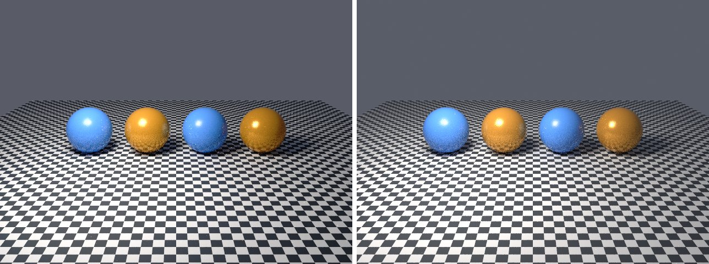

# embree-heavy in lmblender and Blender

Goal: render [examples/embree-heavy.lms](../../../examples/embree-heavy.lms) with lmblender and the same scene with Blender 5.2 from Python, and compare the results.

Left: lmblender. Right: Blender.



`embree-heavy.png`: mean absolute difference 5.0 of 255, silhouette overlap 0.96.

## Timing

| Renderer | Seconds, whole run | Binary |
|---|---|---|
| lmblender | 3.7 | v0.3.4 release |
| Blender 5.2.2 | 10.5 | source build, Cycles CPU, about 0.8 s of it is Blender startup |

Both runs used four threads on a four-core Neoverse-N1 (AWS Graviton2) Linux arm64 host.

## Differences and gaps

- lmblender's Standard view transform renders dark tones darker than Blender (for example 38 instead of 56 out of 255 for a linear value of 0.04), which accounts for most of the difference on dark backgrounds.

## Run both

From the repository root (the Blender command needs Blender 5.x on your PATH):

```sh
mkdir -p build
lmscript examples/embree-heavy.lms
blender -b --factory-startup --python docs/tutorial/blender/py/embree-heavy.py
```

lmblender writes into `build/`; the Blender port writes the same file names into `blender/`.

## Blender port

The port calls [lmb_bpy.py](py/lmb_bpy.py), which implements each lmblender call with bpy and the host's semantics.

<!-- code: blender/py/embree-heavy.py -->
```python
# SPDX-FileCopyrightText: 2025-2026 lmblender contributors
# SPDX-License-Identifier: MIT
# Blender/bpy port of examples/embree-heavy.lms (generated by docs/tutorial/blender/lms2py.py, reviewed by hand)
import os, sys
sys.path.insert(0, os.path.dirname(os.path.abspath(__file__)))
import lmb_bpy

scene = lmb_bpy.Scene()
scene.checker_ground(12.0, 3.0)
blue = scene.material(0.08,0.28,0.86,0.0,0.3,0.0,0.0,0.0,0.0,0.0)
gold = scene.material(0.75,0.34,0.05,0.4,0.22,0.0,0.0,0.0,0.0,0.0)
for i in range(0, 4):
    sphere = scene.uv_sphere(1.1,256,256,True)
    sphere.translate(-4.2+float(i)*2.8,0.0,1.1)
    sphere.set_material(blue if i % 2 == 0 else gold)
scene.world_color(0.2,0.22,0.28,0.5)
scene.area_light(-4.0,-5.0,8.0,0.0,0.0,0.0,1.0,0.9,0.8,1200.0,4.0)
scene.point_light(-3.0,-4.0,6.0,1.0,1.0,1.0,550.0)
scene.camera_look_at(0.0,-16.0,6.0,0.0,0.0,1.0,42.0)
scene.render_settings(8,2026,False)
scene.render_png("blender/embree-heavy.png",16,640,480)
lmb_bpy.done()
```

Back to [the comparison overview](../09-compare-with-blender.md).
