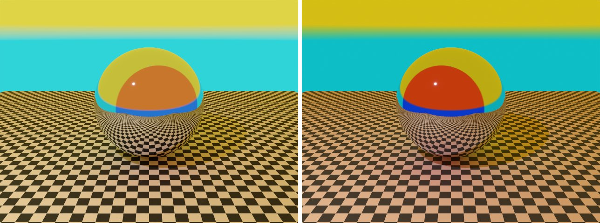

# environment-texture in lmblender and Blender

Goal: render [examples/environment-texture.lms](../../../examples/environment-texture.lms) with lmblender and the same scene with Blender 5.2 from Python, and compare the results.

Left: lmblender. Right: Blender.



`environment-texture.png`: mean absolute difference 19.3 of 255, silhouette overlap 1.00.

## Timing

| Renderer | Seconds, whole run | Binary |
|---|---|---|
| lmblender | 20.1 | local 0.3.3 build (the v0.3.4 linux-arm64 release crashes with SIGILL when denoising on this CPU) |
| Blender 5.2.2 | 26.9 | source build, Cycles CPU, about 0.8 s of it is Blender startup |

Both runs used four threads on a four-core Neoverse-N1 (AWS Graviton2) Linux arm64 host.

## Differences and gaps

- The environment PNG is read without sRGB decoding by lmblender, so the sky and reflections render lighter and less saturated. Telling Blender to read the PNG as non-color data reduced the difference from 19 to 7 out of 255.
- lmblender's Standard view transform renders dark tones darker than Blender (for example 38 instead of 56 out of 255 for a linear value of 0.04), which accounts for most of the difference on dark backgrounds.

## Run both

From the repository root (the Blender command needs Blender 5.x on your PATH):

```sh
mkdir -p build
lmscript examples/environment-texture.lms
blender -b --factory-startup --python docs/tutorial/blender/py/environment-texture.py
```

lmblender writes into `build/`; the Blender port writes the same file names into `blender/`.

## Blender port

The port calls [lmb_bpy.py](py/lmb_bpy.py), which implements each lmblender call with bpy and the host's semantics.

<!-- code: blender/py/environment-texture.py -->
```python
# SPDX-FileCopyrightText: 2025-2026 lmblender contributors
# SPDX-License-Identifier: MIT
# Blender/bpy port of examples/environment-texture.lms (generated by docs/tutorial/blender/lms2py.py, reviewed by hand)
import os, sys
sys.path.insert(0, os.path.dirname(os.path.abspath(__file__)))
import lmb_bpy

scene = lmb_bpy.Scene()
mesh = scene.uv_sphere(1.2,64,40,True)
chrome = scene.material(0.75,0.78,0.82,1.0,0.035,0.0,0.0,0.0,0.0,0.0)
mesh.set_material(chrome)
mesh.translate(0.0,0.0,1.2)
scene.environment_texture("tests/fixtures/environment.png", 22.0, 0.8)
scene.checker_ground(7.0,5.0)
scene.camera_look_at(0.0,-5.8,2.7,0.0,0.0,1.0,45.0)
scene.render_settings(12,22,True)
scene.render_png("blender/environment-texture.png", 128, 640, 480)
lmb_bpy.done()
```

Back to [the comparison overview](../09-compare-with-blender.md).
