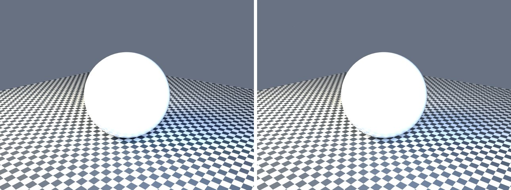

# glass-opaque-control in lmblender and Blender

Goal: render [examples/glass-opaque-control.lms](../../../examples/glass-opaque-control.lms) with lmblender and the same scene with Blender 5.2 from Python, and compare the results.

Left: lmblender. Right: Blender.



`glass-opaque-control.png`: mean absolute difference 1.6 of 255, silhouette overlap 0.98.

## Timing

| Renderer | Seconds, whole run | Binary |
|---|---|---|
| lmblender | 19.9 | local 0.3.3 build (the v0.3.4 linux-arm64 release crashes with SIGILL when denoising on this CPU) |
| Blender 5.2.2 | 17.0 | source build, Cycles CPU, about 0.8 s of it is Blender startup |

Both runs used four threads on a four-core Neoverse-N1 (AWS Graviton2) Linux arm64 host.

## Differences and gaps

- lmblender's Standard view transform renders dark tones darker than Blender (for example 38 instead of 56 out of 255 for a linear value of 0.04), which accounts for most of the difference on dark backgrounds.

## Run both

From the repository root (the Blender command needs Blender 5.x on your PATH):

```sh
mkdir -p build
lmscript examples/glass-opaque-control.lms
blender -b --factory-startup --python docs/tutorial/blender/py/glass-opaque-control.py
```

lmblender writes into `build/`; the Blender port writes the same file names into `blender/`. The lmblender example prints nothing when it succeeds, so check that the image exists; it also leaves its compiled `.dslb` file in `build/`.

## Blender port

The port calls [lmb_bpy.py](py/lmb_bpy.py), which implements each lmblender call with bpy and the host's semantics.

<!-- code: blender/py/glass-opaque-control.py -->
```python
# SPDX-FileCopyrightText: 2025-2026 lmblender contributors
# SPDX-License-Identifier: MIT
# Blender/bpy port of examples/glass-opaque-control.lms (generated by docs/tutorial/blender/lms2py.py, reviewed by hand)
import os, sys
sys.path.insert(0, os.path.dirname(os.path.abspath(__file__)))
import lmb_bpy

scene = lmb_bpy.Scene()
mesh = scene.uv_sphere(1.1,48,32,True)
mesh.translate(0.0,0.0,1.1)
surface = scene.material(0.94,0.97,1.0,0.0,0.04,0.0,0.0,0.0,0.0,0.0)
mesh.set_material(surface)
scene.world_color(0.2, 0.24, 0.32, 0.7)
scene.area_light(-3.0, -4.0, 5.0, 0.0, 0.0, 0.0, 1.0, 0.9, 0.7, 1000.0, 3.0)
scene.area_light(3.0, -2.0, 3.0, 0.0, 0.0, 0.0, 0.55, 0.72, 1.0, 500.0, 2.0)
scene.checker_ground(7.0,6.0)
scene.fit_camera(45.0)
scene.light_clamp(10.0,2.0)
scene.render_settings(12,991,True)
scene.render_png("blender/glass-opaque-control.png",128,640,480)
lmb_bpy.done()
```

Back to [the comparison overview](../09-compare-with-blender.md).
