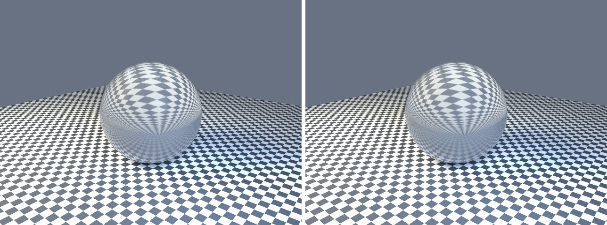

# glass-transmission in lmblender and Blender

Goal: render [examples/glass-transmission.lms](../../../examples/glass-transmission.lms) with lmblender and the same scene with Blender 5.2 from Python, and compare the results.

Left: lmblender. Right: Blender.



`glass-transmission.png`: mean absolute difference 1.2 of 255, silhouette overlap 0.98.

## Timing

| Renderer | Seconds, whole run | Binary |
|---|---|---|
| lmblender | 54.1 | built from source with the fixes on page 11 (v0.3.4 plus the color, camera, and denoiser fixes) |
| Blender 5.2.2 | 45.0 | source build, Cycles CPU, about 0.8 s of it is Blender startup |

Both runs used four threads on a four-core Neoverse-N1 (AWS Graviton2) Linux arm64 host.

## Differences and gaps

- No known differences beyond sampling noise.

## Run both

From the repository root, with lmscript and Blender 5.x on your PATH:

```sh
mkdir -p build
lmscript examples/glass-transmission.lms
blender -b --factory-startup --python docs/tutorial/blender/py/glass-transmission.py
```

Expected lmblender output (the host's JSON result):

```text
{"ok": true, "result": null}
```

Expected Blender output, among Blender's own log lines (seconds vary from run to run):

```text
blender render blender/glass-transmission.png: 43.43s
blender total 43.66s
```

lmblender writes into `build/`, including the compiled `.dslb`; the Blender port writes the same file names into `blender/`. Ubuntu's packaged Blender 4.0 also runs the ports, but without denoising (it has no OpenImageDenoise) and its glTF importer needs `python3-numpy`.

## Blender port

The port calls [lmb_bpy.py](py/lmb_bpy.py), which implements each lmblender call with bpy and the host's semantics.

<!-- code: blender/py/glass-transmission.py -->
```python
# SPDX-FileCopyrightText: 2025-2026 lmblender contributors
# SPDX-License-Identifier: MIT
# Blender/bpy port of examples/glass-transmission.lms (generated by docs/tutorial/blender/lms2py.py, reviewed by hand)
import os, sys
sys.path.insert(0, os.path.dirname(os.path.abspath(__file__)))
import lmb_bpy

scene = lmb_bpy.Scene()
mesh = scene.uv_sphere(1.1,48,32,True)
mesh.translate(0.0,0.0,1.1)
glass = scene.material(0.94,0.97,1.0,0.0,0.04,0.95,0.0,0.0,0.0,0.0)
mesh.set_material(glass)
scene.world_color(0.2, 0.24, 0.32, 0.7)
scene.area_light(-3.0, -4.0, 5.0, 0.0, 0.0, 0.0, 1.0, 0.9, 0.7, 1000.0, 3.0)
scene.area_light(3.0, -2.0, 3.0, 0.0, 0.0, 0.0, 0.55, 0.72, 1.0, 500.0, 2.0)
scene.checker_ground(7.0,6.0)
scene.fit_camera(45.0)
scene.light_clamp(10.0,2.0)
scene.render_settings(12,991,True)
scene.render_png("blender/glass-transmission.png",128,640,480)
lmb_bpy.done()
```

Back to [the comparison overview](../11-compare-with-blender.md).
