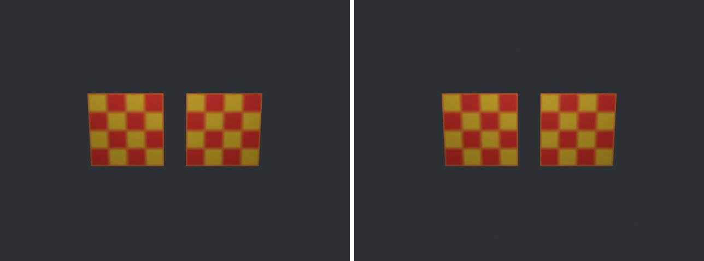

# glb-import in lmblender and Blender

Goal: render [examples/glb-import.lms](../../../examples/glb-import.lms) with lmblender and the same scene with Blender 5.2 from Python, and compare the results.

Left: lmblender. Right: Blender.



`import-gltf-glb.png`: mean absolute difference 0.3 of 255, silhouette overlap 1.00.

## Timing

| Renderer | Seconds, whole run | Binary |
|---|---|---|
| lmblender | 2.4 | built from source with the fixes on page 11 (v0.3.4 plus the color, camera, and denoiser fixes) |
| Blender 5.2.2 | 2.4 | source build, Cycles CPU, about 0.8 s of it is Blender startup |

Both runs used four threads on a four-core Neoverse-N1 (AWS Graviton2) Linux arm64 host.

## Differences and gaps

- Same as gltf-import: vertex counts differ (8 versus 4). The PNG texture matches since the sRGB texture fix; with v0.3.4 the difference was 19.4 of 255.
- Blender `expect_int` checks: expect_int MISMATCH: actual=4 expected=2; expect_int MISMATCH: actual=8 expected=4.

## Run both

From the repository root, with lmscript and Blender 5.x on your PATH:

```sh
mkdir -p build
lmscript examples/glb-import.lms
blender -b --factory-startup --python docs/tutorial/blender/py/glb-import.py
```

Expected lmblender output (the host's JSON result):

```text
{"ok": true, "result": null}
```

Expected Blender output, among Blender's own log lines (seconds vary from run to run):

```text
expect_int MISMATCH: actual=8 expected=4
expect_int MISMATCH: actual=4 expected=2
blender render blender/import-gltf-glb.png: 1.08s
blender total 1.32s
```

lmblender writes into `build/`, including the compiled `.dslb`; the Blender port writes the same file names into `blender/`. Ubuntu's packaged Blender 4.0 also runs the ports, but without denoising (it has no OpenImageDenoise) and its glTF importer needs `python3-numpy`.

## Blender port

The port calls [lmb_bpy.py](py/lmb_bpy.py), which implements each lmblender call with bpy and the host's semantics.

<!-- code: blender/py/glb-import.py -->
```python
# SPDX-FileCopyrightText: 2025-2026 lmblender contributors
# SPDX-License-Identifier: MIT
# Blender/bpy port of examples/glb-import.lms (generated by docs/tutorial/blender/lms2py.py, reviewed by hand)
import os, sys
sys.path.insert(0, os.path.dirname(os.path.abspath(__file__)))
import lmb_bpy

scene = lmb_bpy.Scene()
first = scene.import_gltf("tests/fixtures/gltf/gallery.glb")
scene.expect_int(first.vertex_count(), 4)
scene.expect_int(first.triangle_count(), 2)
scene.world_color(0.22, 0.25, 0.3, 0.12)
scene.area_light(0.0, -4.5, 4.5, 0.0, 0.0, 1.0, 1.0, 0.95, 0.85, 180.0, 4.0)
scene.camera_look_at(0.0, -9.0, 2.8, 0.0, 0.0, 1.0, 42.0)
scene.render_settings(8, 31, False)
scene.render_png("blender/import-gltf-glb.png", 20, 640, 480)
lmb_bpy.done()
```

Back to [the comparison overview](../11-compare-with-blender.md).
