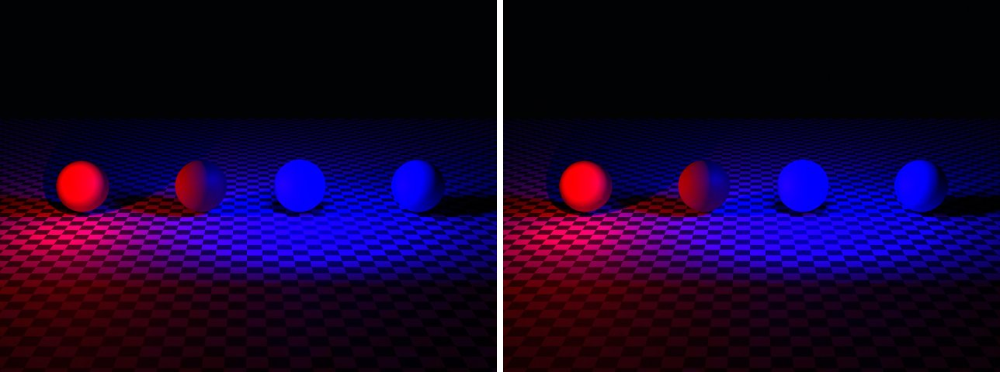

# light-falloff in lmblender and Blender

Goal: render [examples/light-falloff.lms](../../../examples/light-falloff.lms) with lmblender and the same scene with Blender 5.2 from Python, and compare the results.

Left: lmblender. Right: Blender.



`light-falloff.png`: mean absolute difference 0.9 of 255, silhouette overlap 0.97.

## Timing

| Renderer | Seconds, whole run | Binary |
|---|---|---|
| lmblender | 19.9 | built from source with the fixes on page 11 (v0.3.4 plus the color, camera, and denoiser fixes) |
| Blender 5.2.2 | 18.1 | source build, Cycles CPU, about 0.8 s of it is Blender startup |

Both runs used four threads on a four-core Neoverse-N1 (AWS Graviton2) Linux arm64 host.

## Differences and gaps

- No known differences beyond sampling noise.

## Run both

From the repository root, with lmscript and Blender 5.x on your PATH:

```sh
mkdir -p build
lmscript examples/light-falloff.lms
blender -b --factory-startup --python docs/tutorial/blender/py/light-falloff.py
```

Expected lmblender output (the host's JSON result):

```text
{"ok": true, "result": null}
```

Expected Blender output, among Blender's own log lines (seconds vary from run to run):

```text
blender render blender/light-falloff.png: 16.96s
blender total 17.08s
```

lmblender writes into `build/`, including the compiled `.dslb`; the Blender port writes the same file names into `blender/`. Ubuntu's packaged Blender 4.0 also runs the ports, but without denoising (it has no OpenImageDenoise) and its glTF importer needs `python3-numpy`.

## Blender port

The port calls [lmb_bpy.py](py/lmb_bpy.py), which implements each lmblender call with bpy and the host's semantics.

<!-- code: blender/py/light-falloff.py -->
```python
# SPDX-FileCopyrightText: 2025-2026 lmblender contributors
# SPDX-License-Identifier: MIT
# Blender/bpy port of examples/light-falloff.lms (generated by docs/tutorial/blender/lms2py.py, reviewed by hand)
import os, sys
sys.path.insert(0, os.path.dirname(os.path.abspath(__file__)))
import lmb_bpy

scene = lmb_bpy.Scene()
scene.checker_ground(14.0,3.0)
red = scene.material(0.78,0.045,0.025,0.0,0.62,0.0,0.0,0.0,0.0,0.0)
blue = scene.material(0.025,0.15,0.82,0.0,0.62,0.0,0.0,0.0,0.0,0.0)
p_near=scene.uv_sphere(0.66,28,18,True)
p_near.translate(-3.5,0.0,0.7)
p_near.set_material(red)
p_far=scene.uv_sphere(0.66,28,18,True)
p_far.translate(-0.5,0.0,0.7)
p_far.set_material(red)
a_near=scene.uv_sphere(0.66,28,18,True)
a_near.translate(2.0,0.0,0.7)
a_near.set_material(blue)
a_far=scene.uv_sphere(0.66,28,18,True)
a_far.translate(5.0,0.0,0.7)
a_far.set_material(blue)
scene.world_color(0.012,0.016,0.025,0.035)
scene.point_light(-3.5,-1.5,1.4,1.0,0.0,0.0,140.0)
scene.area_light_shape(2.0,-1.5,2.5,2.0,0.0,0.7,0.0,0.0,1.0,500.0,1.5,1.5,"disk")
scene.camera_look_at(0.7,-17.0,5.4,0.7,0.0,0.7,30.0)
scene.render_settings(24,427,True)
scene.render_png("blender/light-falloff.png",64,640,480)
lmb_bpy.done()
```

Back to [the comparison overview](../11-compare-with-blender.md).
