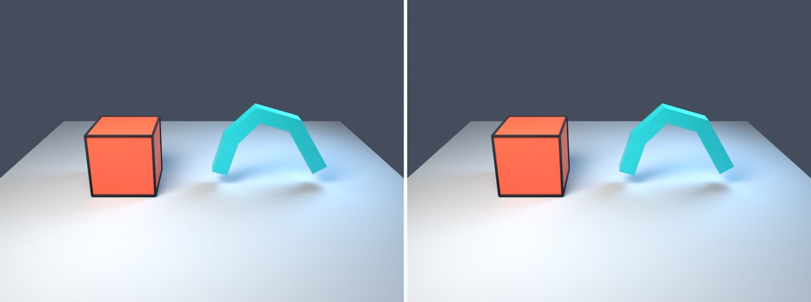

# loft-outline in lmblender and Blender

Goal: render [examples/loft-outline.lms](../../../examples/loft-outline.lms) with lmblender and the same scene with Blender 5.2 from Python, and compare the results.

Left: lmblender. Right: Blender.



`loft-outline.png`: mean absolute difference 0.4 of 255, silhouette overlap 1.00.

## Timing

| Renderer | Seconds, whole run | Binary |
|---|---|---|
| lmblender | 30.1 | built from source with the fixes on page 11 (v0.3.4 plus the color, camera, and denoiser fixes) |
| Blender 5.2.2 | 29.6 | source build, Cycles CPU, about 0.8 s of it is Blender startup |

Both runs used four threads on a four-core Neoverse-N1 (AWS Graviton2) Linux arm64 host.

## Differences and gaps

- Blender `expect_int` checks: expect_int ok: actual=192 expected=192; expect_int ok: actual=20 expected=20; expect_int ok: actual=336 expected=336; expect_int ok: actual=36 expected=36.

## Run both

From the repository root, with lmscript and Blender 5.x on your PATH:

```sh
mkdir -p build
lmscript examples/loft-outline.lms
blender -b --factory-startup --python docs/tutorial/blender/py/loft-outline.py
```

Expected lmblender output (the host's JSON result):

```text
{"ok": true, "result": null}
```

Expected Blender output, among Blender's own log lines (seconds vary from run to run):

```text
expect_int ok: actual=192 expected=192
expect_int ok: actual=336 expected=336
expect_int ok: actual=20 expected=20
expect_int ok: actual=36 expected=36
blender render blender/loft-outline.png: 28.10s
blender total 28.18s
```

lmblender writes into `build/`, including the compiled `.dslb`; the Blender port writes the same file names into `blender/`. Ubuntu's packaged Blender 4.0 also runs the ports, but without denoising (it has no OpenImageDenoise) and its glTF importer needs `python3-numpy`.

## Blender port

The port calls [lmb_bpy.py](py/lmb_bpy.py), which implements each lmblender call with bpy and the host's semantics.

<!-- code: blender/py/loft-outline.py -->
```python
# SPDX-FileCopyrightText: 2025-2026 lmblender contributors
# SPDX-License-Identifier: MIT
# Blender/bpy port of examples/loft-outline.lms (generated by docs/tutorial/blender/lms2py.py, reviewed by hand)
import os, sys
sys.path.insert(0, os.path.dirname(os.path.abspath(__file__)))
import lmb_bpy

scene = lmb_bpy.Scene()
scene.world_color(0.12,0.15,0.22,0.5)
floor = scene.plane(12.0)
floor.set_material(scene.material(0.42,0.47,0.54,0.0,0.8,0.0,0.0,0.0,0.0,0.0))
cube = scene.cube(1.7)
cube.translate(-2.1,0.0,0.9)
cube.set_material(scene.material(0.86,0.10,0.045,0.0,0.54,0.0,0.0,0.0,0.0,0.0))
ink = scene.toon_outline(cube,0.035,0.005,0.008,0.018)
scene.expect_int(ink.vertex_count(),192)
scene.expect_int(ink.triangle_count(),336)
sweep = scene.loft("0.5,0.0,0.4; 0.8,0.0,1.4; 1.5,0.0,2.1; 2.5,0.0,1.8; 3.3,0.0,0.5", "-0.22,-0.22; 0.22,-0.22; 0.22,0.22; -0.22,0.22", True)
scene.expect_int(sweep.vertex_count(),20)
scene.expect_int(sweep.triangle_count(),36)
sweep.set_material(scene.material(0.015,0.68,0.76,0.25,0.32,0.0,0.0,0.0,0.0,0.0))
scene.area_light(-3.0,-4.0,7.0,0.0,0.0,1.0,1.0,0.9,0.76,1200.0,4.0)
scene.area_light(4.0,2.0,5.0,0.0,0.0,1.0,0.45,0.75,1.0,550.0,3.0)
scene.camera_look_at(0.0,-10.0,5.0,0.0,0.0,1.0,43.0)
scene.render_settings(24,532,True)
scene.render_png("blender/loft-outline.png",48,960,720)
lmb_bpy.done()
```

Back to [the comparison overview](../11-compare-with-blender.md).
