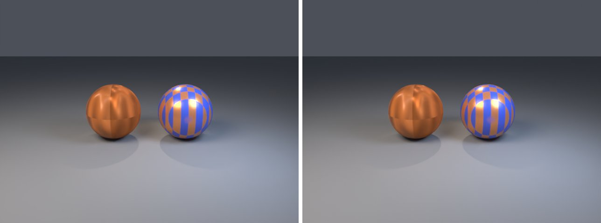
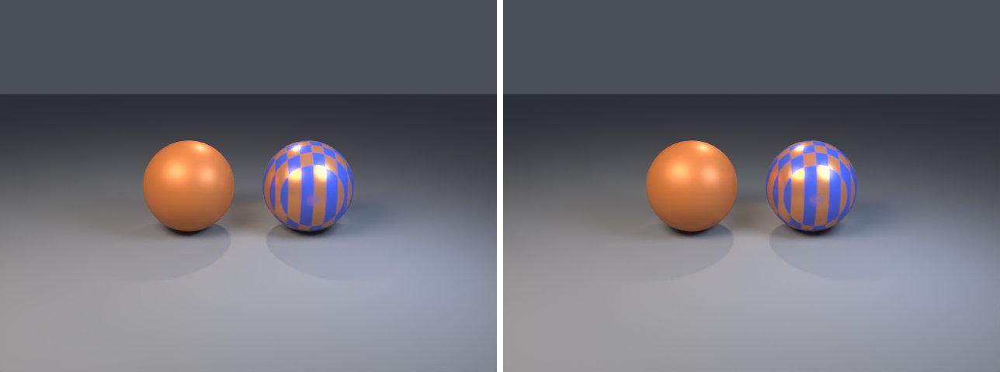
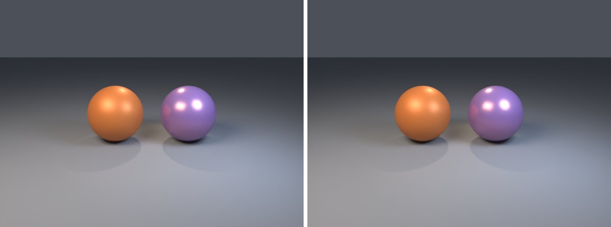

# material-maps in lmblender and Blender

Goal: render [examples/material-maps.lms](../../../examples/material-maps.lms) with lmblender and the same scene with Blender 5.2 from Python, and compare the results.

Left: lmblender. Right: Blender.



`material-maps.png`: mean absolute difference 0.4 of 255, silhouette overlap 1.00.



`material-maps-control.png`: mean absolute difference 0.4 of 255, silhouette overlap 1.00.



`material-mix-factor.png`: mean absolute difference 0.4 of 255, silhouette overlap 1.00.

## Timing

| Renderer | Seconds, whole run | Binary |
|---|---|---|
| lmblender | 59.2 | built from source with the fixes on page 11 (v0.3.4 plus the color, camera, and denoiser fixes) |
| Blender 5.2.2 | 47.2 | source build, Cycles CPU, about 0.8 s of it is Blender startup |

Both runs used four threads on a four-core Neoverse-N1 (AWS Graviton2) Linux arm64 host.

## Differences and gaps

- The textures are committed under tests/fixtures/material-maps, generated by tests/create_material_maps.py.

## Run both

From the repository root, with lmscript and Blender 5.x on your PATH:

```sh
mkdir -p build
lmscript examples/material-maps.lms
blender -b --factory-startup --python docs/tutorial/blender/py/material-maps.py
```

Expected lmblender output (the host's JSON result):

```text
{"ok": true, "result": null}
```

Expected Blender output, among Blender's own log lines (seconds vary from run to run):

```text
blender render blender/material-maps.png: 15.44s
blender render blender/material-maps-control.png: 14.59s
blender render blender/material-mix-factor.png: 15.34s
blender total 45.85s
```

lmblender writes into `build/`, including the compiled `.dslb`; the Blender port writes the same file names into `blender/`. Ubuntu's packaged Blender 4.0 also runs the ports, but without denoising (it has no OpenImageDenoise) and its glTF importer needs `python3-numpy`.

## Blender port

The port calls [lmb_bpy.py](py/lmb_bpy.py), which implements each lmblender call with bpy and the host's semantics.

<!-- code: blender/py/material-maps.py -->
```python
# SPDX-FileCopyrightText: 2025-2026 lmblender contributors
# SPDX-License-Identifier: MIT
# Blender/bpy port of examples/material-maps.lms (generated by docs/tutorial/blender/lms2py.py, reviewed by hand)
import os, sys
sys.path.insert(0, os.path.dirname(os.path.abspath(__file__)))
import lmb_bpy

scene = lmb_bpy.Scene()
textured = scene.uv_sphere(0.88, 48, 24, True)
textured.translate(-1.15, 0.0, 0.90)
mapped = scene.material(0.72, 0.22, 0.055, 0.28, 0.46, 0.0, 0.0, 0.0, 0.0, 0.0)
mapped.texture_maps("tests/fixtures/material-maps/normal.png", "tests/fixtures/material-maps/roughness.png", "tests/fixtures/material-maps/metallic.png", "tests/fixtures/material-maps/ao.png")
textured.set_material(mapped)
layered = scene.uv_sphere(0.88, 48, 24, True)
layered.translate(1.15, 0.0, 0.90)
gold = scene.material(0.82, 0.30, 0.045, 0.52, 0.28, 0.0, 0.0, 0.0, 0.0, 0.0)
blue = scene.material(0.025, 0.11, 0.75, 0.16, 0.34, 0.0, 0.0, 0.0, 0.0, 0.0)
gold.mix_with_texture(blue, "tests/fixtures/material-maps/mix.png")
gold.backface_culling(True)
layered.set_material(gold)
scene.ground_plane(0.0, 28.0, 0.25, 0.27, 0.30)
scene.area_light_shape(-3.8, -4.5, 6.5, 0.0, 0.0, 0.8, 1.0, 0.86, 0.72, 620.0, 4.8, 3.2, "rectangle")
scene.area_light_shape(3.0, -2.5, 4.0, 0.0, 0.0, 0.8, 0.66, 0.78, 1.0, 230.0, 2.4, 2.4, "disk")
scene.spot_light(0.0, 3.0, 5.0, 0.0, 0.0, 0.5, 1.0, 0.76, 0.54, 520.0, 48.0, 0.72)
scene.camera_look_at(0.0, -8.8, 3.5, 0.0, 0.0, 0.9, 43.0)
scene.render_settings(12, 404, True)
scene.render_png("blender/material-maps.png", 48, 640, 480)
mapped.texture_maps("", "", "", "")
scene.render_png("blender/material-maps-control.png", 48, 640, 480)
gold.mix_with(blue, 0.5)
scene.render_png("blender/material-mix-factor.png", 48, 640, 480)
lmb_bpy.done()
```

Back to [the comparison overview](../11-compare-with-blender.md).
