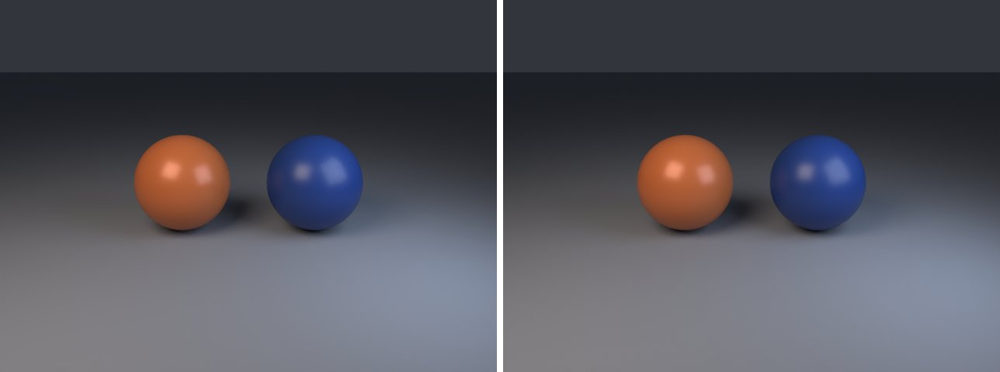

# material-nodes-control in lmblender and Blender

Goal: render [examples/material-nodes-control.lms](../../../examples/material-nodes-control.lms) with lmblender and the same scene with Blender 5.2 from Python, and compare the results.

Left: lmblender. Right: Blender.



`material-nodes-control.png`: mean absolute difference 0.3 of 255, silhouette overlap 1.00.

## Timing

| Renderer | Seconds, whole run | Binary |
|---|---|---|
| lmblender | 20.1 | built from source with the fixes on page 11 (v0.3.4 plus the color, camera, and denoiser fixes) |
| Blender 5.2.2 | 17.9 | source build, Cycles CPU, about 0.8 s of it is Blender startup |

Both runs used four threads on a four-core Neoverse-N1 (AWS Graviton2) Linux arm64 host.

## Differences and gaps

- No known differences beyond sampling noise.

## Run both

From the repository root, with lmscript and Blender 5.x on your PATH:

```sh
mkdir -p build
lmscript examples/material-nodes-control.lms
blender -b --factory-startup --python docs/tutorial/blender/py/material-nodes-control.py
```

Expected lmblender output (the host's JSON result):

```text
{"ok": true, "result": null}
```

Expected Blender output, among Blender's own log lines (seconds vary from run to run):

```text
blender render blender/material-nodes-control.png: 16.40s
blender total 16.67s
```

lmblender writes into `build/`, including the compiled `.dslb`; the Blender port writes the same file names into `blender/`. Ubuntu's packaged Blender 4.0 also runs the ports, but without denoising (it has no OpenImageDenoise) and its glTF importer needs `python3-numpy`.

## Blender port

The port calls [lmb_bpy.py](py/lmb_bpy.py), which implements each lmblender call with bpy and the host's semantics.

<!-- code: blender/py/material-nodes-control.py -->
```python
# SPDX-FileCopyrightText: 2025-2026 lmblender contributors
# SPDX-License-Identifier: MIT
# Blender/bpy port of examples/material-nodes-control.lms (generated by docs/tutorial/blender/lms2py.py, reviewed by hand)
import os, sys
sys.path.insert(0, os.path.dirname(os.path.abspath(__file__)))
import lmb_bpy

scene = lmb_bpy.Scene()
a = scene.uv_sphere(1.05, 48, 24, True)
a.translate(-1.45,0.0,1.08)
red = scene.material(0.68,0.18,0.055,0.08,0.3,0.0,0.0,0.0,0.0,0.0)
a.set_material(red)
b = scene.uv_sphere(1.05,48,24,True)
b.translate(1.45,0.0,1.08)
teal = scene.material(0.02,0.055,0.24,0.0,0.34,0.0,0.0,0.0,0.0,0.0)
b.set_material(teal)
scene.ground_plane(-0.02,60.0,0.28,0.30,0.34)
scene.world_color(0.16,0.18,0.22,0.2)
scene.area_light(-4.0,-6.0,7.0,0.0,0.0,0.8,1.0,0.85,0.72,460.0,5.0)
scene.area_light(4.0,-3.0,4.0,0.0,0.0,1.0,0.65,0.78,1.0,220.0,4.0)
scene.camera_look_at(0.0,-9.5,4.0,0.0,0.0,1.0,45.0)
scene.render_settings(12,91,True)
scene.render_png("blender/material-nodes-control.png",48,640,480)
lmb_bpy.done()
```

Back to [the comparison overview](../11-compare-with-blender.md).
