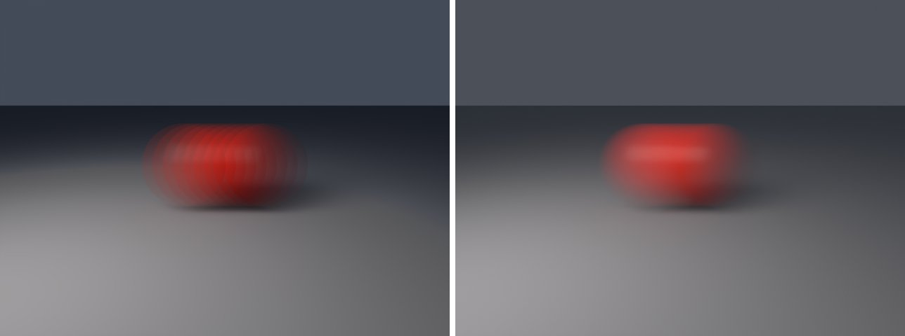
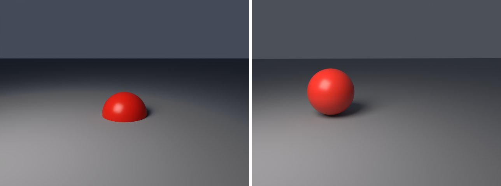

# motion-blur in lmblender and Blender

Goal: render [examples/motion-blur.lms](../../../examples/motion-blur.lms) with lmblender and the same scene with Blender 5.2 from Python, and compare the results.

Left: lmblender. Right: Blender.



`motion-blur-2.png`: mean absolute difference 6.1 of 255, silhouette overlap 0.96.



`motion-control.png`: mean absolute difference 10.0 of 255, silhouette overlap 0.93.

## Timing

| Renderer | Seconds, whole run | Binary |
|---|---|---|
| lmblender | 108.6 | local 0.3.3 build (the v0.3.4 linux-arm64 release crashes with SIGILL when denoising on this CPU) |
| Blender 5.2.2 | 16.9 | source build, Cycles CPU, about 0.8 s of it is Blender startup |

Both runs used four threads on a four-core Neoverse-N1 (AWS Graviton2) Linux arm64 host.

## Differences and gaps

- The port bakes object and camera keys at frame -0.5, 0, and +0.5 as Blender subframe keys, matching the host's three motion steps. lmblender took much longer on this scene.
- lmblender's Standard view transform renders dark tones darker than Blender (for example 38 instead of 56 out of 255 for a linear value of 0.04), which accounts for most of the difference on dark backgrounds.

## Run both

From the repository root (the Blender command needs Blender 5.x on your PATH):

```sh
mkdir -p build
lmscript examples/motion-blur.lms
blender -b --factory-startup --python docs/tutorial/blender/py/motion-blur.py
```

lmblender writes into `build/`; the Blender port writes the same file names into `blender/`. The lmblender example prints nothing when it succeeds, so check that the image exists; it also leaves its compiled `.dslb` file in `build/`.

## Blender port

The port calls [lmb_bpy.py](py/lmb_bpy.py), which implements each lmblender call with bpy and the host's semantics.

<!-- code: blender/py/motion-blur.py -->
```python
# SPDX-FileCopyrightText: 2025-2026 lmblender contributors
# SPDX-License-Identifier: MIT
# Blender/bpy port of examples/motion-blur.lms (generated by docs/tutorial/blender/lms2py.py, reviewed by hand)
import os, sys
sys.path.insert(0, os.path.dirname(os.path.abspath(__file__)))
import lmb_bpy

scene = lmb_bpy.Scene()
sphere = scene.uv_sphere(0.82, 48, 24, True)
red = scene.material(0.85, 0.035, 0.02, 0.0, 0.32, 0.0, 0.0, 0.0, 0.0, 0.0)
sphere.set_material(red)
sphere.keyframe_transform(1, -1.6, 0.0, 0.86, "linear")
sphere.keyframe_transform(3, 1.6, 0.0, 0.86, "linear")
scene.ground_plane(0.0, 24.0, 0.27, 0.29, 0.32)
scene.area_light(-3.5, -4.0, 5.0, 0.0, 0.0, 0.5, 1.0, 0.9, 0.82, 420.0, 4.0)
scene.camera_look_at(0.0, -8.0, 2.7, 0.0, 0.0, 0.8, 44.0)
scene.camera_keyframe(1, -0.3, -8.0, 2.7, 0.0, 0.0, 0.8, "linear")
scene.camera_keyframe(3, 0.3, -8.0, 2.7, 0.0, 0.0, 0.8, "linear")
scene.render_settings(24, 53, True)
scene.motion_blur(True, 1.0)
scene.render_sequence("blender/motion-blur-{frame}.png", 2, 2, 48, 640, 480)
scene.motion_blur(False, 1.0)
scene.render_png("blender/motion-control.png", 48, 640, 480)
lmb_bpy.done()
```

Back to [the comparison overview](../09-compare-with-blender.md).
