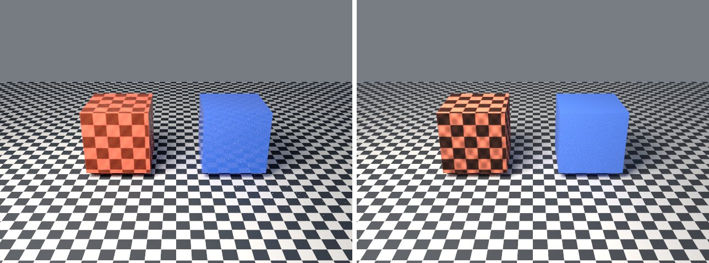

# obj-mtl-gallery in lmblender and Blender

Goal: render [examples/obj-mtl-gallery.lms](../../../examples/obj-mtl-gallery.lms) with lmblender and the same scene with Blender 5.2 from Python, and compare the results.

Left: lmblender. Right: Blender.



`obj-mtl-gallery.png`: mean absolute difference 5.8 of 255, silhouette overlap 0.99.

## Timing

| Renderer | Seconds, whole run | Binary |
|---|---|---|
| lmblender | 6.6 | v0.3.4 release |
| Blender 5.2.2 | 5.5 | source build, Cycles CPU, about 0.8 s of it is Blender startup |

Both runs used four threads on a four-core Neoverse-N1 (AWS Graviton2) Linux arm64 host.

## Differences and gaps

- Needs the generated OBJ/MTL fixture: run `python3 tests/create_obj_mtl_fixture.py build/obj-mtl-assets` first. Blender's OBJ importer converts the MTL itself, so the materials are close but not identical.
- Blender `expect_int` checks: expect_int ok: actual=16 expected=16; expect_int ok: actual=2 expected=2; expect_int ok: actual=24 expected=24.
- lmblender's Standard view transform renders dark tones darker than Blender (for example 38 instead of 56 out of 255 for a linear value of 0.04), which accounts for most of the difference on dark backgrounds.

## Run both

From the repository root (the Blender command needs Blender 5.x on your PATH):

```sh
mkdir -p build
lmscript examples/obj-mtl-gallery.lms
blender -b --factory-startup --python docs/tutorial/blender/py/obj-mtl-gallery.py
```

lmblender writes into `build/`; the Blender port writes the same file names into `blender/`.

## Blender port

The port calls [lmb_bpy.py](py/lmb_bpy.py), which implements each lmblender call with bpy and the host's semantics.

<!-- code: blender/py/obj-mtl-gallery.py -->
```python
# SPDX-FileCopyrightText: 2025-2026 lmblender contributors
# SPDX-License-Identifier: MIT
# Blender/bpy port of examples/obj-mtl-gallery.lms (generated by docs/tutorial/blender/lms2py.py, reviewed by hand)
import os, sys
sys.path.insert(0, os.path.dirname(os.path.abspath(__file__)))
import lmb_bpy

scene = lmb_bpy.Scene()
pair = scene.import_obj("build/obj-mtl-assets/study.obj")
scene.expect_int(pair.vertex_count(), 16)
scene.expect_int(pair.triangle_count(), 24)
scene.expect_int(pair.material_count(), 2)
scene.checker_ground(8.0, 4.0)
scene.world_color(0.34, 0.37, 0.42, 0.55)
scene.area_light(-3.0, -4.0, 6.0, 0.0, 0.0, 0.8, 1.0, 0.90, 0.78, 1000.0, 4.0)
scene.camera_look_at(0.0, -7.5, 4.0, 0.0, 0.0, 0.85, 42.0)
scene.render_settings(8, 1928, False)
scene.render_png("blender/obj-mtl-gallery.png", 32, 640, 480)
lmb_bpy.done()
```

Back to [the comparison overview](../09-compare-with-blender.md).
