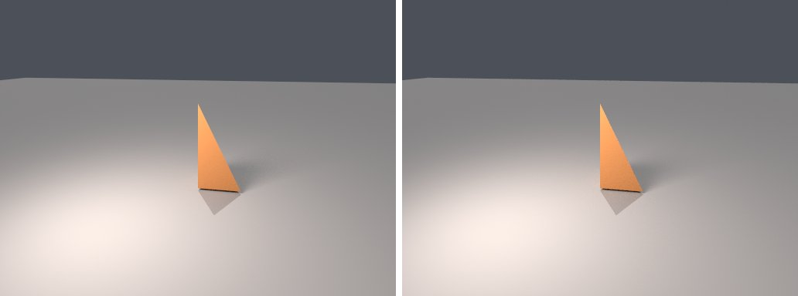
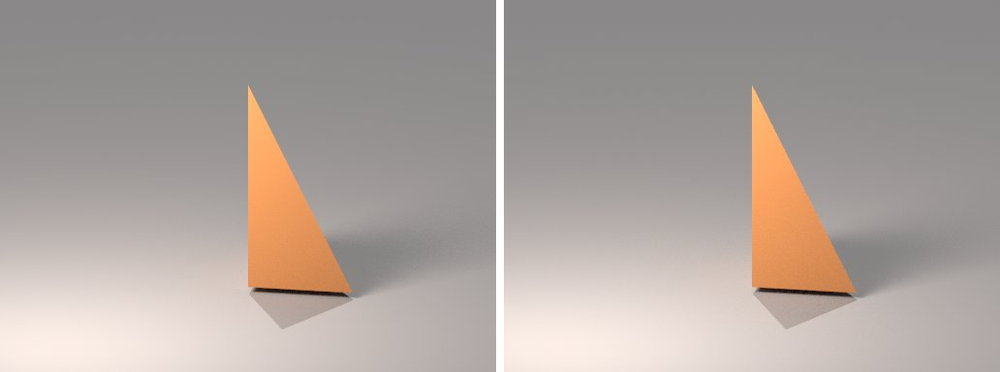

# orthographic-camera in lmblender and Blender

Goal: render [examples/orthographic-camera.lms](../../../examples/orthographic-camera.lms) with lmblender and the same scene with Blender 5.2 from Python, and compare the results.

Left: lmblender. Right: Blender.



`perspective-reference.png`: mean absolute difference 0.5 of 255, silhouette overlap 1.00.



`orthographic-camera.png`: mean absolute difference 0.7 of 255, silhouette overlap 0.97.

## Timing

| Renderer | Seconds, whole run | Binary |
|---|---|---|
| lmblender | 26.2 | built from source with the fixes on page 11 (v0.3.4 plus the color, camera, and denoiser fixes) |
| Blender 5.2.2 | 23.9 | source build, Cycles CPU, about 0.8 s of it is Blender startup |

Both runs used four threads on a four-core Neoverse-N1 (AWS Graviton2) Linux arm64 host.

## Differences and gaps

- No known differences beyond sampling noise.

## Run both

From the repository root, with lmscript and Blender 5.x on your PATH:

```sh
mkdir -p build
lmscript examples/orthographic-camera.lms
blender -b --factory-startup --python docs/tutorial/blender/py/orthographic-camera.py
```

Expected lmblender output (the host's JSON result):

```text
{"ok": true, "result": null}
```

Expected Blender output, among Blender's own log lines (seconds vary from run to run):

```text
blender render blender/perspective-reference.png: 9.51s
blender render blender/orthographic-camera.png: 12.73s
blender total 22.37s
```

lmblender writes into `build/`, including the compiled `.dslb`; the Blender port writes the same file names into `blender/`. Ubuntu's packaged Blender 4.0 also runs the ports, but without denoising (it has no OpenImageDenoise) and its glTF importer needs `python3-numpy`.

## Blender port

The port calls [lmb_bpy.py](py/lmb_bpy.py), which implements each lmblender call with bpy and the host's semantics.

<!-- code: blender/py/orthographic-camera.py -->
```python
# SPDX-FileCopyrightText: 2025-2026 lmblender contributors
# SPDX-License-Identifier: MIT
# Blender/bpy port of examples/orthographic-camera.lms (generated by docs/tutorial/blender/lms2py.py, reviewed by hand)
import os, sys
sys.path.insert(0, os.path.dirname(os.path.abspath(__file__)))
import lmb_bpy

scene = lmb_bpy.Scene()
mesh = scene.import_obj("tests/fixtures/tetra.obj")
clay = scene.material(0.55, 0.24, 0.08, 0.0, 0.62, 0.0, 0.0, 0.0, 0.0, 0.0)
mesh.set_material(clay)
scene.ground_plane(-0.12, 60.0, 0.28, 0.3, 0.34)
scene.sun_light(0.25, -0.5, -1.0, 1.0, 0.9, 0.78, 2.4, 0.2)
scene.area_light(-4.0, -5.0, 7.0, 0.0, 0.0, 1.5, 1.0, 0.8, 0.65, 1800.0, 4.0)
scene.camera_look_at(2.2, -12.0, 6.0, 0.0, 0.0, 2.0, 55.0)
scene.render_png("blender/perspective-reference.png", 64, 512, 384)
scene.camera_orthographic(2.2, -12.0, 6.0, 0.0, 0.0, 2.0, 7.0)
scene.render_png("blender/orthographic-camera.png", 64, 512, 384)
lmb_bpy.done()
```

Back to [the comparison overview](../11-compare-with-blender.md).
