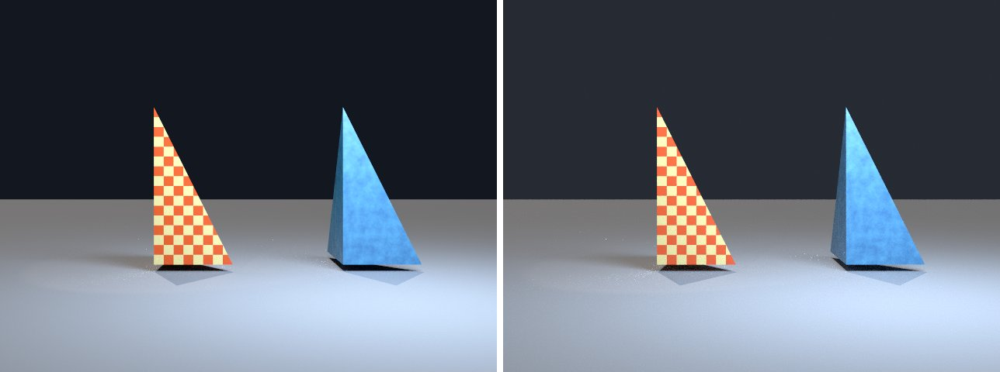

# procedural-materials in lmblender and Blender

Goal: render [examples/procedural-materials.lms](../../../examples/procedural-materials.lms) with lmblender and the same scene with Blender 5.2 from Python, and compare the results.

Left: lmblender. Right: Blender.



`procedural-materials.png`: mean absolute difference 11.0 of 255, silhouette overlap 1.00.

## Timing

| Renderer | Seconds, whole run | Binary |
|---|---|---|
| lmblender | 10.8 | v0.3.4 release |
| Blender 5.2.2 | 9.3 | source build, Cycles CPU, about 0.8 s of it is Blender startup |

Both runs used four threads on a four-core Neoverse-N1 (AWS Graviton2) Linux arm64 host.

## Differences and gaps

- Textures use object-space coordinates on both sides (standalone Cycles fills generated coordinates from object positions).
- lmblender's Standard view transform renders dark tones darker than Blender (for example 38 instead of 56 out of 255 for a linear value of 0.04), which accounts for most of the difference on dark backgrounds.

## Run both

From the repository root (the Blender command needs Blender 5.x on your PATH):

```sh
mkdir -p build
lmscript examples/procedural-materials.lms
blender -b --factory-startup --python docs/tutorial/blender/py/procedural-materials.py
```

lmblender writes into `build/`; the Blender port writes the same file names into `blender/`.

## Blender port

The port calls [lmb_bpy.py](py/lmb_bpy.py), which implements each lmblender call with bpy and the host's semantics.

<!-- code: blender/py/procedural-materials.py -->
```python
# SPDX-FileCopyrightText: 2025-2026 lmblender contributors
# SPDX-License-Identifier: MIT
# Blender/bpy port of examples/procedural-materials.lms (generated by docs/tutorial/blender/lms2py.py, reviewed by hand)
import os, sys
sys.path.insert(0, os.path.dirname(os.path.abspath(__file__)))
import lmb_bpy

scene = lmb_bpy.Scene()
checker_mesh = scene.import_obj("tests/fixtures/tetra.obj")
checker_mesh.translate(-2.4, 0.0, 0.0)
checker = scene.checker_material(0.9, 0.12, 0.035, 0.95, 0.78, 0.34, 4.0, 0.36)
checker_mesh.set_material(checker)
noise_mesh = scene.instance_mesh(checker_mesh, 2.4, 0.0, 0.0, 1.0, 1.0, 1.0)
noise = scene.noise_material(0.018, 0.075, 0.24, 0.13, 0.42, 0.68, 3.5, 0.42)
noise_mesh.set_material(noise)
scene.ground_plane(-0.18, 80.0, 0.24, 0.26, 0.3)
scene.world_color(0.08, 0.1, 0.14, 0.24)
scene.sun_light(0.2, -0.5, -1.0, 1.0, 0.9, 0.78, 2.2, 0.3)
scene.spot_light(-5.0, -6.0, 7.0, -2.4, 0.0, 1.2, 1.0, 0.72, 0.5, 420.0, 48.0, 0.25)
scene.area_light(3.0, -5.0, 7.0, 2.4, 0.0, 1.0, 0.65, 0.82, 1.0, 1900.0, 5.0)
scene.camera_look_at(0.0, -15.0, 2.0, 0.0, 0.0, 2.0, 35.0)
scene.render_settings(8, 31, False)
scene.render_png("blender/procedural-materials.png", 96, 640, 480)
lmb_bpy.done()
```

Back to [the comparison overview](../09-compare-with-blender.md).
