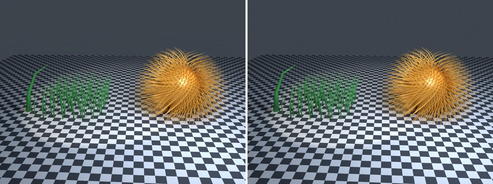

# strands-showcase in lmblender and Blender

Goal: render [examples/strands-showcase.lms](../../../examples/strands-showcase.lms) with lmblender and the same scene with Blender 5.2 from Python, and compare the results.

Left: lmblender. Right: Blender.



`strands-showcase.png`: mean absolute difference 1.5 of 255, silhouette overlap 0.98.

## Timing

| Renderer | Seconds, whole run | Binary |
|---|---|---|
| lmblender | 45.2 | built from source with the fixes on page 11 (v0.3.4 plus the color, camera, and denoiser fixes) |
| Blender 5.2.2 | 45.8 | source build, Cycles CPU, about 0.8 s of it is Blender startup |

Both runs used four threads on a four-core Neoverse-N1 (AWS Graviton2) Linux arm64 host.

## Differences and gaps

- No known differences beyond sampling noise.

## Run both

From the repository root, with lmscript and Blender 5.x on your PATH:

```sh
mkdir -p build
lmscript examples/strands-showcase.lms
blender -b --factory-startup --python docs/tutorial/blender/py/strands-showcase.py
```

Expected lmblender output (the host's JSON result):

```text
{"ok": true, "result": null}
```

Expected Blender output, among Blender's own log lines (seconds vary from run to run):

```text
blender render blender/strands-showcase.png: 44.41s
blender total 44.87s
```

lmblender writes into `build/`, including the compiled `.dslb`; the Blender port writes the same file names into `blender/`. Ubuntu's packaged Blender 4.0 also runs the ports, but without denoising (it has no OpenImageDenoise) and its glTF importer needs `python3-numpy`.

## Blender port

The port calls [lmb_bpy.py](py/lmb_bpy.py), which implements each lmblender call with bpy and the host's semantics.

<!-- code: blender/py/strands-showcase.py -->
```python
# SPDX-FileCopyrightText: 2025-2026 lmblender contributors
# SPDX-License-Identifier: MIT
# Blender/bpy port of examples/strands-showcase.lms (generated by docs/tutorial/blender/lms2py.py, reviewed by hand)
import os, sys
sys.path.insert(0, os.path.dirname(os.path.abspath(__file__)))
import lmb_bpy

scene = lmb_bpy.Scene()
scene.checker_ground(12.0, 3.0)
scene.world_color(0.12, 0.15, 0.19, 0.38)
green = scene.material(0.045,0.38,0.075,0.0,0.52,0.0,0.0,0.0,0.0,0.0)
gold = scene.material(0.82,0.4,0.045,0.12,0.28,0.0,0.0,0.0,0.0,0.0)
fur = scene.uv_sphere(1.0,32,20,True)
fur.translate(2.1,0.0,1.05)
fur.set_material(gold)
hair = scene.hair_sphere(2.1,0.0,1.05,1.0,680,1.15,0.018)
hair.set_material(gold)
grass = scene.hair_patch(-3.0,0.0,0.0,3.2,72,1.6,0.028)
grass.set_material(green)
curl = scene.strand("-5.15,-0.7,0.0; -5.0,-0.7,0.95; -4.55,-0.7,1.9; -3.85,-0.7,2.35",0.13,0.0,12)
curl.set_material(green)
scene.spot_light(-3.0,-5.0,7.0,-1.8,0.0,0.5,1.0,0.9,0.72,1000.0,56.0,0.3)
scene.area_light(3.0,-4.0,6.0,1.0,0.0,1.0,0.72,0.82,1.0,700.0,4.0)
scene.camera_look_at(0.0,-11.0,5.0,-0.6,0.0,0.8,42.0)
scene.render_settings(20,731,True)
scene.render_png("blender/strands-showcase.png",64,960,720)
lmb_bpy.done()
```

Back to [the comparison overview](../11-compare-with-blender.md).
