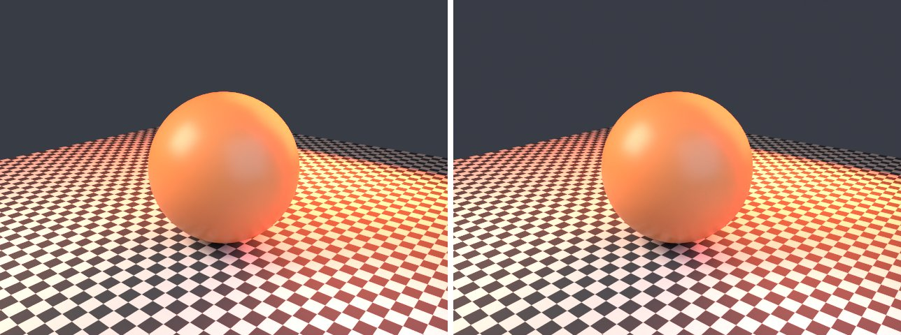

# subsurface-control in lmblender and Blender

Goal: render [examples/subsurface-control.lms](../../../examples/subsurface-control.lms) with lmblender and the same scene with Blender 5.2 from Python, and compare the results.

Left: lmblender. Right: Blender.



`subsurface-control.png`: mean absolute difference 1.2 of 255, silhouette overlap 1.00.

## Timing

| Renderer | Seconds, whole run | Binary |
|---|---|---|
| lmblender | 21.1 | built from source with the fixes on page 11 (v0.3.4 plus the color, camera, and denoiser fixes) |
| Blender 5.2.2 | 16.9 | source build, Cycles CPU, about 0.8 s of it is Blender startup |

Both runs used four threads on a four-core Neoverse-N1 (AWS Graviton2) Linux arm64 host.

## Differences and gaps

- No known differences beyond sampling noise.

## Run both

From the repository root, with lmscript and Blender 5.x on your PATH:

```sh
mkdir -p build
lmscript examples/subsurface-control.lms
blender -b --factory-startup --python docs/tutorial/blender/py/subsurface-control.py
```

Expected lmblender output (the host's JSON result):

```text
{"ok": true, "result": null}
```

Expected Blender output, among Blender's own log lines (seconds vary from run to run):

```text
blender render blender/subsurface-control.png: 15.86s
blender total 15.97s
```

lmblender writes into `build/`, including the compiled `.dslb`; the Blender port writes the same file names into `blender/`. Ubuntu's packaged Blender 4.0 also runs the ports, but without denoising (it has no OpenImageDenoise) and its glTF importer needs `python3-numpy`.

## Blender port

The port calls [lmb_bpy.py](py/lmb_bpy.py), which implements each lmblender call with bpy and the host's semantics.

<!-- code: blender/py/subsurface-control.py -->
```python
# SPDX-FileCopyrightText: 2025-2026 lmblender contributors
# SPDX-License-Identifier: MIT
# Blender/bpy port of examples/subsurface-control.lms (generated by docs/tutorial/blender/lms2py.py, reviewed by hand)
import os, sys
sys.path.insert(0, os.path.dirname(os.path.abspath(__file__)))
import lmb_bpy

scene = lmb_bpy.Scene()
mesh = scene.uv_sphere(1.1,48,32,True)
mesh.translate(0.0,0.0,1.1)
skin = scene.material(0.82, 0.28, 0.09, 0.0, 0.38, 0.0, 0.0, 0.0, 0.0, 0.0)
mesh.set_material(skin)
scene.world_color(0.08, 0.09, 0.12, 0.5)
scene.area_light(-3.0, -4.0, 5.0, 0.0, 0.0, 0.0, 1.0, 0.72, 0.55, 650.0, 3.5)
scene.area_light(3.0, -1.0, 2.5, 0.0, 0.0, 0.0, 0.5, 0.7, 1.0, 90.0, 3.0)
scene.area_light(0.0,4.0,3.0,0.0,0.0,1.0,1.0,0.12,0.03,2600.0,5.0)
scene.light_clamp(12.0,3.0)
scene.checker_ground(7.0,5.0)
scene.fit_camera(45.0)
scene.render_settings(12,177,True)
scene.render_png("blender/subsurface-control.png", 96, 640, 480)
lmb_bpy.done()
```

Back to [the comparison overview](../11-compare-with-blender.md).
