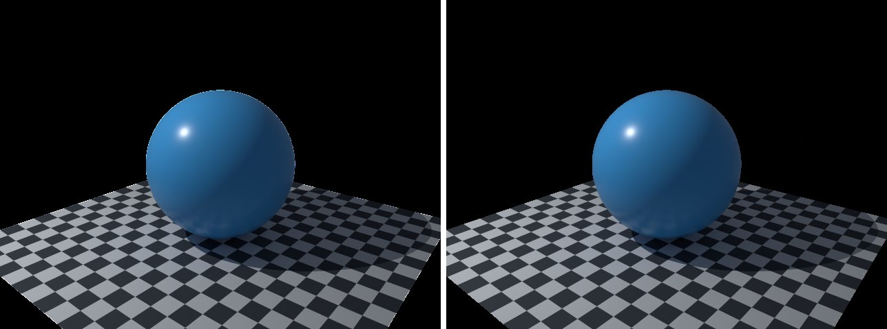

# transparent-film in lmblender and Blender

Goal: render [examples/transparent-film.lms](../../../examples/transparent-film.lms) with lmblender and the same scene with Blender 5.2 from Python, and compare the results.

Left: lmblender. Right: Blender.



`transparent-film.png`: mean absolute difference 0.5 of 255, silhouette overlap 1.00.

## Timing

| Renderer | Seconds, whole run | Binary |
|---|---|---|
| lmblender | 11.0 | built from source with the fixes on page 11 (v0.3.4 plus the color, camera, and denoiser fixes) |
| Blender 5.2.2 | 16.0 | source build, Cycles CPU, about 0.8 s of it is Blender startup |

Both runs used four threads on a four-core Neoverse-N1 (AWS Graviton2) Linux arm64 host.

## Differences and gaps

- No known differences beyond sampling noise.

## Run both

From the repository root, with lmscript and Blender 5.x on your PATH:

```sh
mkdir -p build
lmscript examples/transparent-film.lms
blender -b --factory-startup --python docs/tutorial/blender/py/transparent-film.py
```

Expected lmblender output (the host's JSON result):

```text
{"ok": true, "result": null}
```

Expected Blender output, among Blender's own log lines (seconds vary from run to run):

```text
blender render blender/transparent-film.png: 14.66s
blender total 14.77s
```

lmblender writes into `build/`, including the compiled `.dslb`; the Blender port writes the same file names into `blender/`. Ubuntu's packaged Blender 4.0 also runs the ports, but without denoising (it has no OpenImageDenoise) and its glTF importer needs `python3-numpy`.

## Blender port

The port calls [lmb_bpy.py](py/lmb_bpy.py), which implements each lmblender call with bpy and the host's semantics.

<!-- code: blender/py/transparent-film.py -->
```python
# SPDX-FileCopyrightText: 2025-2026 lmblender contributors
# SPDX-License-Identifier: MIT
# Blender/bpy port of examples/transparent-film.lms (generated by docs/tutorial/blender/lms2py.py, reviewed by hand)
import os, sys
sys.path.insert(0, os.path.dirname(os.path.abspath(__file__)))
import lmb_bpy

scene = lmb_bpy.Scene()
mesh = scene.uv_sphere(1.0,48,32,True)
mesh.translate(0.0,0.0,1.0)
mesh.set_material(scene.material(0.06,0.42,0.92,0.0,0.3,0.0,0.0,0.0,0.0,0.0))
scene.checker_ground(2.5,4.0)
scene.fit_camera(46.0)
scene.transparent_background(True)
scene.render_settings(12,23,True)
scene.render_png("blender/transparent-film.png", 64, 640, 480)
lmb_bpy.done()
```

Back to [the comparison overview](../11-compare-with-blender.md).
